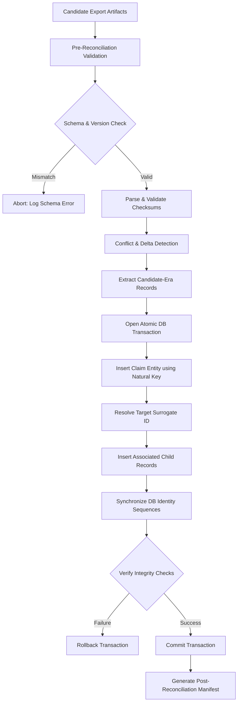

# ClaimGuard Phase D — Step D1: Data Model and Reconciliation Design

> **Document Reference:** `docs/phase-d-reconciliation-design.md`  
> **Author:** Senior Software Architect, Database Engineer & DevOps Auditor  
> **Date:** October 25, 2026  
> **Project:** ClaimGuard — Claim Fraud Review Dashboard  
> **Target Subsystem:** Post-Rollback Data Reconciliation Architecture  
> **Operational Status:** DESIGN ONLY — No application source code, databases, or runtime containers have been modified.

---

## 1. Executive Summary & Objective

During the ClaimGuard Phase 1 deployment lifecycle, an emergency rollback from the file-backed H2 candidate container (`claimguard:phase1-candidate`) to the legacy in-memory container (`claimguard:stitch-ui-staging`) restores service availability on port 8083. However, because the legacy application operates on an ephemeral in-memory database (`jdbc:h2:mem:claimguard`), candidate-era transactions (claims and review histories created while the candidate was running) are absent from the active legacy instance.

This document establishes the formal data model inspection, collision risk analysis, and technical design for a robust, idempotent data-reconciliation mechanism. It addresses how candidate-era claims and audit trails can be safely restored without primary key collisions, data corruption, timestamp drift, or loss of historical audit integrity.

---

## 2. Codebase Inspection & Schema Findings

An exhaustive inspection of the ClaimGuard Java Spring Boot codebase was performed across entity models, JPA repositories, services, controllers, and database configurations.

### 2.1 Files Inspected
- **Entity Classes:**
  - `src/main/java/com/claimguard/dashboard/entity/Claim.java`
  - `src/main/java/com/claimguard/dashboard/entity/ReviewHistory.java`
  - `src/main/java/com/claimguard/dashboard/entity/SuspiciousIndicator.java`
  - `src/main/java/com/claimguard/dashboard/entity/ClaimDocument.java`
  - `src/main/java/com/claimguard/dashboard/entity/ClaimStatus.java`
  - `src/main/java/com/claimguard/dashboard/entity/ClaimType.java`
  - `src/main/java/com/claimguard/dashboard/entity/RiskPriority.java`
- **Data Repositories:**
  - `src/main/java/com/claimguard/dashboard/repository/ClaimRepository.java`
  - `src/main/java/com/claimguard/dashboard/repository/ReviewHistoryRepository.java`
  - `src/main/java/com/claimguard/dashboard/repository/SuspiciousIndicatorRepository.java`
  - `src/main/java/com/claimguard/dashboard/repository/ClaimDocumentRepository.java`
- **Business Services & Rule Engines:**
  - `src/main/java/com/claimguard/dashboard/service/ClaimService.java`
  - `src/main/java/com/claimguard/dashboard/service/DataSeederService.java`
  - `src/main/java/com/claimguard/dashboard/rules/IndicatorRuleEngine.java`
- **Controllers & DTOs:**
  - `src/main/java/com/claimguard/dashboard/controller/ClaimController.java`
  - `src/main/java/com/claimguard/dashboard/controller/ReviewController.java`
  - `src/main/java/com/claimguard/dashboard/controller/HealthController.java`
  - `src/main/java/com/claimguard/dashboard/dto/CreateClaimRequest.java`
  - `src/main/java/com/claimguard/dashboard/dto/ClaimDetailDTO.java`
  - `src/main/java/com/claimguard/dashboard/dto/ClaimSummaryDTO.java`
  - `src/main/java/com/claimguard/dashboard/dto/DocumentMetadataRequest.java`
  - `src/main/java/com/claimguard/dashboard/dto/ReviewDecisionRequest.java`

### 2.2 Relational Entity Schema

```mermaid
erDiagram
    CLAIMS ||--o{ CLAIM_DOCUMENTS : "has"
    CLAIMS ||--o{ SUSPICIOUS_INDICATORS : "evaluates"
    CLAIMS ||--o{ REVIEW_HISTORY : "tracks"

    CLAIMS {
        bigint id PK "IDENTITY"
        varchar(30) claim_reference UK "Unique Business Key"
        varchar(50) policy_number
        varchar(100) claimant_name
        varchar(30) contact_phone
        varchar(100) contact_email
        varchar(20) claim_type
        timestamp incident_date
        timestamp submission_date
        decimal(12,2) claimed_amount
        decimal(12,2) approved_amount
        varchar(30) status
        varchar(20) risk_priority
        varchar(2000) incident_description
        varchar(30) vehicle_reg_number
        varchar(150) incident_location
        varchar(100) assigned_reviewer
    }

    REVIEW_HISTORY {
        bigint id PK "IDENTITY"
        bigint claim_id FK "References claims(id)"
        varchar(50) action_type
        varchar(30) previous_status
        varchar(30) new_status
        varchar(100) reviewer_name
        varchar(2000) reviewer_remarks
        timestamp action_timestamp
    }

    SUSPICIOUS_INDICATORS {
        bigint id PK "IDENTITY"
        bigint claim_id FK "References claims(id)"
        varchar(30) rule_code
        varchar(150) title
        varchar(20) severity
        varchar(1000) description
        timestamp triggered_timestamp
    }

    CLAIM_DOCUMENTS {
        bigint id PK "IDENTITY"
        bigint claim_id FK "References claims(id)"
        varchar(255) file_name
        varchar(50) document_type
        bigint file_size_bytes
        varchar(64) sha256_hash
        timestamp uploaded_timestamp
    }
```

---

## 3. Identifier Generation & Collision Analysis

### 3.1 Primary Surrogate Key (`id`) Generation
- In both `Claim.java` and `ReviewHistory.java`, the primary key uses:
  ```java
  @Id
  @GeneratedValue(strategy = GenerationType.IDENTITY)
  private Long id;
  ```
- In H2, `GenerationType.IDENTITY` relies on the database's internal auto-increment identity sequence (`AUTO_INCREMENT`).
- **Primary Key Collision Hazard:**
  - In a freshly started legacy instance, the auto-increment identity starts at 1. `DataSeederService` inserts 5 baseline claims, assigning IDs `1, 2, 3, 4, 5`.
  - In the candidate container, claims were created on top of the baseline, taking IDs `6, 7, ...`.
  - **Risk 1:** If records are imported into a target database by inserting with explicit surrogate IDs (`id=6`, `id=7`), H2's internal sequence generator is **not automatically advanced**. Any subsequent user creating a claim via `POST /api/claims` will attempt to use the next sequence value (e.g., 6), resulting in an immediate primary key constraint violation:
    `Unique index or primary key violation: "PRIMARY KEY ON PUBLIC.CLAIMS(ID)"`
  - **Risk 2:** If records are imported via naive `POST /api/claims`, the database generates a brand new ID, completely disconnecting any exported review history records whose foreign keys point to the candidate ID `6` or `7`.

### 3.2 Business Key (`claim_reference`) Generation
- In `ClaimService.java` (lines 83–85):
  ```java
  long nextSeq = claimRepository.count() + 1;
  String reference = String.format("CLM-%d-%04d", Year.now().getValue(), nextSeq);
  ```
- The claim reference follows the deterministic pattern `CLM-YYYY-NNNN` (e.g., `CLM-2026-0006`).
- It has an explicit database unique constraint:
  ```java
  @Column(name = "claim_reference", nullable = false, unique = true, length = 30)
  ```
- **Business Key Anchor:** Unlike surrogate numeric IDs, `claim_reference` is a **globally stable natural identifier**. It is unique, immutable after creation, and human-readable across all instances.

---

## 4. Review History & Referential Integrity Analysis

### 4.1 Relationship Structure
- `ReviewHistory` has a strict Many-to-One foreign key constraint pointing to `Claim`:
  ```java
  @ManyToOne(fetch = FetchType.LAZY)
  @JoinColumn(name = "claim_id", nullable = false)
  @JsonBackReference
  private Claim claim;
  ```
- The `ReviewHistory` entity lacks a natural business key; it relies entirely on its surrogate `id` and foreign key `claim_id`.

### 4.2 Audit Event Generation in Application Lifecycle
- Audit records are generated strictly as side effects of workflow transitions:
  1. `createClaim`: Creates initial history entry with `action_type = "SUBMITTED"`, `new_status = SUBMITTED`, `reviewer_name = "System Intake"`.
  2. `startReview`: Appends history entry with `action_type = "REVIEW_STARTED"`, `previous_status = SUBMITTED`, `new_status = UNDER_REVIEW`.
  3. `approveClaim`: Appends history entry with `action_type = "APPROVED"`, `new_status = APPROVED`.
  4. `rejectClaim`: Appends history entry with `action_type = "REJECTED"`, `new_status = REJECTED`.
  5. `requestMoreInfo`: Appends history entry with `action_type = "INFO_REQUESTED"`, `new_status = INFO_REQUESTED`.

### 4.3 Referential Integrity Risks on Record Replay
- If claims and history are imported separately or out of sequence, database foreign key constraints will reject history rows whose parent claim does not yet exist.
- If a claim's surrogate ID changes upon import (e.g., candidate ID 6 becomes target ID 8), any review history record referencing foreign key `6` will either fail referential integrity or attach to the wrong claim.
- Historical audit timestamps (`action_timestamp`) are set to `LocalDateTime.now()` by the service. Replaying history via state-transition endpoints would overwrite historical audit times with the current clock time, violating audit trail immutability.

---

## 5. Existing Export/Import Capabilities & Critical Gaps

### 5.1 Existing Read-Only Export Formats
The application currently provides standard REST endpoints:
- `GET /api/claims?page=X&size=Y`: Returns paginated Spring Data JPA JSON containing claims with risk priority, amounts, and claimant details.
- `GET /api/claims/{id}/history`: Returns JSON array of `ReviewHistory` objects with action types, statuses, reviewer names, remarks, and ISO-8601 timestamps.
- `GET /api/claims/{id}/indicators`: Returns evaluated suspicious indicators.

### 5.2 Absence of Import / Reconciliation Endpoints
Inspection of all controllers confirmed:
- **There is ZERO existing import capability.** No `/api/claims/import`, no batch upload endpoint, and no reconciliation runner exists in the codebase.
- **Why Naive Re-Posting Fails:** Attempting to restore candidate records by calling `POST /api/claims` produces severe data corruption:
  1. **Timestamp Corruption:** `submission_date` is forcibly set to `LocalDateTime.now()`, destroying the original submission record.
  2. **Audit History Loss:** The claim is reset to status `SUBMITTED`, discarding all intermediate review events (`UNDER_REVIEW`, `APPROVED`, etc.).
  3. **Rule Re-Evaluation Drift:** `ruleEngine.evaluateRules(claim)` runs again against the current system state, potentially altering heuristic scores.
  4. **Reference Desynchronization:** If any claims were created or removed, `count() + 1` may generate a conflicting reference.

---

## 6. Detailed Reconciliation Architecture Design

To achieve true data reconciliation without application side effects, the reconciliation mechanism must be designed as an **Atomic, Idempotent Reconciliation Service (AIRS)**.



### 6.1 Architectural Pillars

#### 1. Schema & Version Validation
- The import manifest must record the schema version and application version (`1.0.0-SNAPSHOT`).
- The reconciliation engine validates that all required entity columns and enumerations (`MOTOR, HEALTH, PROPERTY`, `SUBMITTED, UNDER_REVIEW, APPROVED, REJECTED, INFO_REQUESTED`) match the target database schema before initiating ingestion.

#### 2. Stable Natural Key Resolution (`claim_reference`)
- The surrogate database `id` must **never** be used as the reconciliation matching key.
- The business key `claim_reference` (`CLM-YYYY-NNNN`) serves as the immutable anchor:
  - If `claimRepository.findByClaimReference(ref)` exists: The claim is identified as a baseline or pre-existing record.
  - If absent: The claim is classified as a candidate-era delta record requiring ingestion.

#### 3. Idempotency & Duplicate Prevention
- Import operations must be strictly idempotent: running the reconciliation multiple times against the same export payload must yield identical database state without duplicate rows.
- Duplicate prevention rules:
  - **Claims:** Deduplicated on `claim_reference`.
  - **Review History:** Deduplicated by composite tuple: `(claim_reference, action_type, new_status, action_timestamp)`.
  - **Suspicious Indicators:** Deduplicated on `(claim_reference, rule_code)`.
  - **Documents:** Deduplicated on `(claim_reference, sha256_hash)`.

#### 4. Referential Integrity & Foreign Key Remapping
- The reconciliation service maintains an in-memory session translation map:
  $$\text{Map}\langle\text{String } (\text{claim\_reference}), \text{Long } (\text{Target Assigned ID})\rangle$$
- Child entities (`ReviewHistory`, `SuspiciousIndicator`, `ClaimDocument`) are linked directly to the newly persisted target `Claim` entity, ensuring foreign keys resolve to valid surrogate IDs in the target database.

#### 5. Identity Sequence Synchronization (H2 Specific)
- Following the insertion of candidate claims, the database identity sequence must be explicitly advanced to prevent future ID collisions during live operation:
  ```sql
  ALTER TABLE claims ALTER COLUMN id RESTART WITH (SELECT MAX(id) + 1 FROM claims);
  ALTER TABLE review_history ALTER COLUMN id RESTART WITH (SELECT MAX(id) + 1 FROM review_history);
  ALTER TABLE suspicious_indicators ALTER COLUMN id RESTART WITH (SELECT MAX(id) + 1 FROM suspicious_indicators);
  ALTER TABLE claim_documents ALTER COLUMN id RESTART WITH (SELECT MAX(id) + 1 FROM claim_documents);
  ```

#### 6. Transactional Import & Failure Rollback
- Ingestion must execute within a single Spring `@Transactional(rollbackFor = Exception.class)` boundary.
- If any single claim, document, or review history record fails validation or violates database constraints, the entire transaction rolls back cleanly, leaving the target database in its original baseline state.

#### 7. Audit Logging Without Secret Leakage
- Log messages must strictly record operational metrics:
  - Ingestion timestamp
  - Source manifest SHA-256
  - Number of claims evaluated, skipped, and inserted
  - Reference numbers of reconciled claims (`CLM-2026-0006`)
- No credentials, tokens, or PII (claimant phone numbers, emails, passwords) may appear in reconciliation logs.

#### 8. Pre-Import Backup & Post-Import Verification Gate
- Prior to running reconciliation, an automated pre-import snapshot is captured.
- Following ingestion, the reconciliation gate verifies:
  1. Target database count equals $\text{Baseline Count} + \text{Candidate Delta Count}$.
  2. Every reconciled claim reference responds with HTTP 200 via `GET /api/claims/reference/{reference}`.
  3. Every associated review history entry is retrievable via `GET /api/claims/{id}/history`.
  4. Sequence generator successfully produces a non-colliding test record.

---

## 7. Technical Feasibility Assessment: In-Memory vs. Persistent Target

A fundamental architectural question is whether reconciliation should target the **legacy in-memory H2 application** or a **persistent file-backed database**.

| Architectural Dimension | Legacy In-Memory Target (`jdbc:h2:mem:claimguard`) | Persistent File-Backed Target (`jdbc:h2:file:...`) |
| :--- | :--- | :--- |
| **Persistence Across Container Restarts** | **ZERO (Fatal Limitation):** Stopping, crashing, or restarting the container completely clears RAM, losing all reconciled candidate data instantly. | **COMPLETE:** Database engine flushes to Docker volume `claimguard-data`. Survives all container restarts and rollbacks. |
| **Operational Rationale** | Contradictory: Restoring candidate data into volatile RAM creates the exact same data-loss vulnerability that Phase 1 was commissioned to fix. | Coherent: Reconciles data into permanent storage where claims and review histories remain permanently queryable. |
| **Data Integrity Verification** | Ephemeral; cannot be inspected offline or validated by independent tooling without keeping container active. | Full; offline files (`claimguard.mv.db`) can be checksummed, backed up, and inspected. |
| **Engineering Feasibility** | Feasible only while the specific container process lives; lost on next deployment cutover. | Highly feasible; establishes the stable foundation for Phase 1 production operation. |

### Technical Conclusion & Architectural Recommendation
Reconciling data into an ephemeral in-memory database is an **unstable and self-defeating operational pattern**. True reconciliation must target a **persistent database**.
1. **During Rollback:** The rollback procedure preserves the candidate volume `claimguard-data` and exports claims/history to offline JSON snapshots. Service availability is restored to baseline on port 8083.
2. **Post-Rollback Recovery:** When candidate fixes are ready for deployment, the service starts with persistent volume `claimguard-data`, which **already natively contains all candidate-era records**.
3. **If Extended In-Memory Operation Is Required:** If the legacy service must remain active for an extended period and business users require access to candidate claims, the reconciliation mechanism designed herein should be executed as a dedicated Spring Boot CLI utility or integration endpoint that ingests candidate JSON exports directly into the active instance.

---

## 8. Proposed Implementation & Test Plan

### Step D2: Implementation Architecture (To Be Executed After Review Approval)
1. **DTO Specification:** Create `ReconciliationPayloadDTO.java` representing the unified claims and review-history snapshot.
2. **Reconciliation Service:** Implement `ClaimReconciliationService.java` providing:
   - `reconcileFromPayload(ReconciliationPayloadDTO payload)`
   - Sequence synchronization via native JDBC queries
   - Duplicate detection on `claim_reference`
3. **Administrative Endpoint:** Expose a secure, role-restricted endpoint `POST /api/admin/reconcile` protected by `hasRole('ADMIN')` and CSRF validation.

### Step D3: Isolated Validation & Test Plan
1. **Unit & Integration Tests:**
   - Test reconciliation with clean baseline: verify 5 baseline + 2 candidate = 7 total claims.
   - Test idempotency: execute identical reconciliation twice; verify count remains exactly 7 without duplicates.
   - Test sequence advancement: create new claim via standard API; verify assigned ID is 8 with no primary key collision.
   - Test rollback on failure: inject corrupted claim payload; verify entire batch rolls back to baseline.
2. **Isolated Docker Test:** Run test in a disposable candidate container on port 18085 with isolated volume.

---

## 9. Deliverables & Safety Compliance Record

### 9.1 Files Created or Modified
- **Created Design Specification:** [`docs/phase-d-reconciliation-design.md`](file:///e:/Desktop/Raj%20Yadav/Projects/Claim-Fraud-Review-Dashboard/docs/phase-d-reconciliation-design.md)
- **Application Source Code:** **ZERO CHANGES** (No Java classes, configuration, or database files modified).

### 9.2 Strict Safety Affirmations
- **Section 5 Live Cutover:** **NOT EXECUTED** (Remains on hold).
- **Staging Service on Port 8083:** Container `claimguard-staging` (`910771a20872`) is **UP, healthy, and untouched**.
- **Credentials:** No secrets, tokens, or passwords were logged or exposed.
- **Next Action:** Awaiting owner review and explicit authorization before proceeding to implementation (Step D2).
