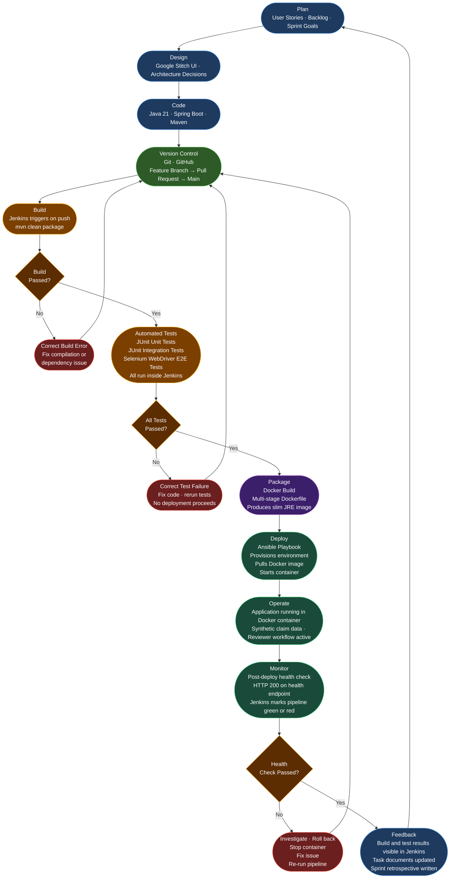

# Task 02 — Agile Planning and DevOps Workflow

**Project Title:** Jenkins Deployment for a Claim Fraud Review Dashboard 
**Document Version:** 1.0 
**Date:** 2026-10-21 
**Author:** Raj Yadav 
**Status:** Draft — Under Review

> **Important notice:** All items in this document describe **planned work**. No sprints have been executed, no backlog items have been completed, and no ceremonies have taken place. All statuses are set to "To Do" or "Planned" to accurately reflect the current state of the project.

---

## Table of Contents

1. [Introduction](#1-introduction)
2. [Agile Methodology](#2-agile-methodology)
3. [User Stories](#3-user-stories)
4. [Acceptance Criteria](#4-acceptance-criteria)
5. [Prioritized Product Backlog](#5-prioritized-product-backlog)
6. [Fifteen-Item Internal Kanban Board](#6-fifteen-item-internal-kanban-board)
7. [Sprint Plan](#7-sprint-plan)
8. [Definition of Ready](#8-definition-of-ready)
9. [Definition of Done](#9-definition-of-done)
10. [DevOps Lifecycle Diagram](#10-devops-lifecycle-diagram)
11. [Mapping to All 14 Official Assignment Tasks](#11-mapping-to-all-14-official-assignment-tasks)
12. [Risk and Dependency Register](#12-risk-and-dependency-register)
13. [Task 2 Deliverables Checklist](#13-task-2-deliverables-checklist)
14. [Viva Preparation](#14-viva-preparation)

---

## 1. Introduction

### Why Agile Planning and a DevOps Workflow Are Useful for This Project

Software projects — even academic ones — rarely go exactly as planned. Requirements evolve, tools behave differently than expected, and integrations between components reveal problems that were not visible on paper. Agile planning addresses this by breaking the project into small, manageable units of work, reviewing progress frequently, and adjusting the plan when reality diverges from intention.

For this project specifically, Agile and DevOps thinking are valuable for the following reasons:

**Breaking a complex project into manageable pieces.** 
The project spans fourteen official tasks covering UI design, backend development, automated testing, containerisation, and pipeline automation. Attempting to plan and execute all fourteen at once would be overwhelming and error-prone. A sprint-based approach allows each task to be planned, built, tested, and documented before the next begins.

**Detecting integration problems early.** 
The most likely failure points — for example, whether the Google Stitch export integrates cleanly with the chosen frontend approach, or whether Selenium tests run stably inside Jenkins — will only become visible when components are actually connected. Short feedback cycles mean these problems surface quickly while there is still time to correct them.

**Maintaining a traceable audit trail.** 
Academic assessors evaluate not just the final product but the quality of the process. User stories, acceptance criteria, a backlog, and a sprint plan together demonstrate that the project was planned deliberately, not improvised. Every item can be traced from requirement to implementation to test.

**Applying DevOps principles from the start.** 
DevOps is not just a set of tools; it is a culture of continuous improvement, automation, and collaboration between development and operations roles. By thinking about the CI/CD pipeline, container strategy, and test automation as first-class concerns from Task 1 onward — not as afterthoughts — the project embeds DevOps thinking into its planning, not just its tooling.

**Supporting honest progress reporting.** 
A backlog with clear statuses makes it straightforward to report truthfully on what has been done and what has not. This project will never claim work is complete when it is only planned.

---

## 2. Agile Methodology

### Scrum-Inspired Approach with a Kanban Board

This project uses a **lightweight Scrum-inspired approach** adapted for a solo academic developer. Full Scrum requires a team (Product Owner, Scrum Master, Development Team) and strict ceremony scheduling; adapting it sensibly for one person produces a practical workflow without the overhead.

### What This Means in Practice

**Product Backlog.** 
A prioritised list of all work items required to complete the project. Items are described as user stories or technical tasks, each with acceptance criteria and a priority level. The backlog is a living document: items can be added, reprioritised, or refined as the project progresses.

**Sprints.** 
Work is organised into time-boxed periods of roughly one to two weeks. Each sprint has a written goal, a set of backlog items committed for that sprint, and an exit criterion that must be met before the sprint is closed. Sprints map roughly to the fourteen official tasks, with some tasks grouped together where their scope is small.

**Sprint Planning (Proposed — not yet performed).** 
At the start of each sprint, the student reviews the backlog, selects the highest-priority items that can realistically be completed in the sprint window, and documents the sprint goal. This planning is recorded in this document and updated as sprints are completed.

**Daily Progress Reviews (Solo Adaptation).** 
In a full Scrum team, developers hold a short daily standup meeting. For a solo project, this becomes a daily written log entry: what was worked on, what was completed, and what is blocked. This provides a record of actual progress versus the plan.

**Sprint Review (Proposed — not yet performed).** 
At the end of each sprint, the student reviews the work completed against the exit criteria. Evidence is captured (screenshots, test reports, git log output) and the corresponding task document is updated.

**Sprint Retrospective (Proposed — not yet performed).** 
After the review, a brief written reflection is added to the task document: what went well, what was harder than expected, and what will be done differently in the next sprint. This feeds directly into Task 14 (Project Retrospective and Lessons Learned).

**Kanban Board.** 
A visual board with four columns — **To Do**, **In Progress**, **Review**, **Done** — tracks the status of every work item. Section 6 of this document contains the fifteen internal Kanban items for this project. The board is updated manually as work progresses.

> **Formal Scrum ceremonies have not taken place.** No sprint has been started, no standup has been held, and no review has occurred. The descriptions above are the planned process.

---

## 3. User Stories

The following user stories describe the functionality expected from the system from the perspective of each type of user. They are written in the standard Agile format.

> **Format:** "As a [user], I want [capability], so that [benefit]."

All user stories reflect **planned functionality**. None have been implemented at the time of writing.

---

### Claim Submission

**US-01 — Submit a New Claim** 
As a **claim submitter**, I want to fill in and submit a structured claim form with claimant name, policy number, claim type, incident date, claim amount, and description, so that a new claim is created in the system and assigned a unique Claim ID.

**US-02 — Input Validation Feedback** 
As a **claim submitter**, I want the form to clearly indicate which fields are missing or invalid before I submit, so that I can correct errors without losing the information I have already entered.

**US-03 — Document Metadata Capture** 
As a **claim submitter**, I want to enter document metadata (document type, reference number, and upload date) alongside the claim details, so that supporting document information is associated with the claim from the point of submission.

---

### Claim Listing and Search

**US-04 — View All Claims** 
As a **fraud reviewer**, I want to see a list of all submitted claims with their Claim ID, claimant name, status, indicator count, and submission date, so that I can quickly identify which claims require attention.

**US-05 — Search by Claim ID** 
As a **claim submitter** or **fraud reviewer**, I want to search for a claim by its Claim ID, so that I can retrieve the full details of a specific claim without scrolling through the entire list.

---

### Suspicious Indicators

**US-06 — View Suspicious Indicators** 
As a **fraud reviewer**, I want to see a clear list of suspicious indicators triggered for a claim, each with a plain-language description, so that I can understand why the system has flagged the claim without needing to re-examine the raw data myself.

**US-07 — Indicator Disclaimer** 
As a **fraud reviewer**, I want each suspicious indicator to be clearly labelled as a decision-support signal and accompanied by a disclaimer that it does not constitute proof of fraud, so that I am not misled into treating automated flags as definitive conclusions.

---

### Reviewer Actions

**US-08 — Approve a Claim** 
As a **fraud reviewer**, I want to record an "Approved" decision with written remarks on a claim, so that the claim status is updated, the decision is stored, and the audit trail reflects the approval.

**US-09 — Reject a Claim** 
As a **fraud reviewer**, I want to record a "Rejected" decision with mandatory written remarks explaining the reason, so that the decision is stored, the claimant's representative has a documented reason, and the audit trail reflects the rejection.

---

### Status Tracking and Review History

**US-10 — Track Claim Status** 
As a **claim submitter**, I want to look up a claim by its Claim ID and see its current status (Pending / Approved / Rejected), so that I know whether a decision has been made without needing to contact a reviewer directly.

**US-11 — View Full Review History** 
As a **fraud reviewer** or **operations manager**, I want to see the complete chronological history of all review decisions recorded for a claim, including reviewer name, decision, remarks, and timestamp, so that I can understand how the claim has been handled over time.

---

### Automated Testing

**US-12 — Automated End-to-End Test Coverage** 
As a **DevOps engineer**, I want at least five Selenium WebDriver tests to cover the critical user journeys (claim submission, indicator display, approve decision, reject decision, and status lookup), so that any regression introduced by a code change is detected automatically before the build is promoted.

---

### CI/CD Deployment

**US-13 — Automated Pipeline on Code Push** 
As a **DevOps engineer**, I want the Jenkins pipeline to trigger automatically on every push to the main branch, execute the build, run all tests, build a Docker image, and deploy the container via Ansible, so that every code change is validated and deployed without any manual steps.

**US-14 — Failed Pipeline Blocks Deployment** 
As a **DevOps engineer**, I want the Jenkins pipeline to stop immediately if any build or test stage fails and to report the failure clearly, so that broken code is never deployed to the target environment.

---

### System Health and Recovery

**US-15 — Post-Deploy Health Check** 
As a **DevOps engineer**, I want the Jenkins pipeline to confirm that the deployed application is reachable on the expected port after container startup, so that a deployment that produces a container that fails to start is caught automatically rather than discovered by a user.

---

## 4. Acceptance Criteria

Acceptance criteria define the specific, testable conditions that must be true for each user story to be considered complete. Each criterion is a binary pass/fail statement.

> All criteria are **planned targets**. None have been verified through testing at the time of writing.

---

### US-01 — Submit a New Claim

| # | Criterion | Pass Condition | Fail Condition |
|---|-----------|---------------|----------------|
| AC-01.1 | Form accepts a complete, valid claim. | System creates the claim, assigns a unique Claim ID, sets status to PENDING, and displays a confirmation message. | No Claim ID is generated; no confirmation shown. |
| AC-01.2 | Claim ID format is consistent and unique. | Each submission produces a distinct Claim ID; no two submissions share an ID in the seed dataset. | Duplicate or missing Claim IDs observed. |
| AC-01.3 | All six mandatory fields are present in the stored record. | Retrieving the claim by ID shows all six submitted field values unchanged. | Any field is missing or corrupted in storage. |

### US-02 — Input Validation Feedback

| # | Criterion | Pass Condition | Fail Condition |
|---|-----------|---------------|----------------|
| AC-02.1 | Empty mandatory field prevents submission. | Form does not submit; the empty field is highlighted with an inline error message. | Form submits with a blank mandatory field. |
| AC-02.2 | Invalid claim amount (non-numeric, zero, or negative) is rejected. | Error message is shown adjacent to the amount field; previously entered values in other fields are preserved. | Invalid amount accepted and stored; or all fields are cleared on error. |
| AC-02.3 | Invalid date format is rejected. | Error message identifies the date field and states the expected format; form does not submit. | Invalid date stored; or no error message shown. |
| AC-02.4 | Claim type must be one of the three allowed values. | Form only accepts "health", "motor", or "property"; any other value is rejected. | Unexpected claim type accepted. |

### US-03 — Document Metadata Capture

| # | Criterion | Pass Condition | Fail Condition |
|---|-----------|---------------|----------------|
| AC-03.1 | Document type, reference number, and upload date are stored. | Retrieving the claim by ID shows all three document metadata fields with the submitted values. | Any metadata field is missing from the stored record. |
| AC-03.2 | Empty document metadata is handled gracefully. | If document metadata fields are optional and left blank, the form still submits successfully with a note indicating no document information was provided. | Application throws an error on missing optional document fields. |

### US-04 — View All Claims

| # | Criterion | Pass Condition | Fail Condition |
|---|-----------|---------------|----------------|
| AC-04.1 | Claim list shows all submitted claims. | Every claim in the seed dataset appears in the list. | Any seeded claim is absent from the list. |
| AC-04.2 | Columns show Claim ID, claimant name, status, indicator count, and submission date. | All five columns are populated for every row. | Any column is blank or missing. |
| AC-04.3 | List is sortable by each column. | Clicking a column header sorts the list ascending; clicking again sorts descending. | Column headers do not sort the list. |

### US-05 — Search by Claim ID

| # | Criterion | Pass Condition | Fail Condition |
|---|-----------|---------------|----------------|
| AC-05.1 | Valid Claim ID returns the correct claim detail page. | Searching for a known Claim ID navigates to that claim's detail page. | Wrong claim displayed; or no result shown. |
| AC-05.2 | Unknown Claim ID shows a clear "not found" message. | Searching for a non-existent ID displays an informative message; no stack trace or blank page. | Application shows an error page or blank result. |

### US-06 — View Suspicious Indicators

| # | Criterion | Pass Condition | Fail Condition |
|---|-----------|---------------|----------------|
| AC-06.1 | All triggered indicators are displayed on the claim detail page. | For a synthetic claim designed to trigger two specific rules, both indicators appear with plain-language descriptions. | Fewer indicators shown than expected; or descriptions are technical error messages. |
| AC-06.2 | Claims with no triggered indicators show a clear "no indicators" message. | A synthetic claim designed to trigger no rules displays a "no suspicious signals detected" message. | Zero-indicator claim shows a blank section or throws an error. |
| AC-06.3 | Indicator count on the claim list matches the detail page. | The number in the indicator count column matches the count of indicators shown on the detail page for the same claim. | Counts differ between list and detail views. |

### US-07 — Indicator Disclaimer

| # | Criterion | Pass Condition | Fail Condition |
|---|-----------|---------------|----------------|
| AC-07.1 | Disclaimer is visible on the claim detail page whenever indicators are shown. | The text "These signals do not constitute proof of fraud" (or equivalent approved wording) is present on any claim detail page that shows at least one indicator. | Disclaimer is absent from a page showing indicators. |

### US-08 — Approve a Claim

| # | Criterion | Pass Condition | Fail Condition |
|---|-----------|---------------|----------------|
| AC-08.1 | Approval with remarks updates claim status to APPROVED. | After submitting the approval decision, the claim status changes to APPROVED on both the list and detail pages. | Status does not change; or error is shown. |
| AC-08.2 | Approval without remarks is rejected. | Submitting the approval form with an empty remarks field shows an inline error and does not save the decision. | Approval is stored with empty remarks. |
| AC-08.3 | Approval is appended to review history. | The review history on the claim detail page shows a new entry with the reviewer name, "Approved" decision, the entered remarks, and a timestamp. | Entry is absent from history; or wrong data is shown. |

### US-09 — Reject a Claim

| # | Criterion | Pass Condition | Fail Condition |
|---|-----------|---------------|----------------|
| AC-09.1 | Rejection with remarks updates claim status to REJECTED. | After submitting the rejection decision, the claim status changes to REJECTED on both the list and detail pages. | Status does not change; or error is shown. |
| AC-09.2 | Rejection without remarks is rejected. | Submitting the rejection form with an empty remarks field shows an inline error and does not save the decision. | Rejection is stored with empty remarks. |
| AC-09.3 | Rejection reason is visible in review history. | The review history shows the rejection entry with remarks that explain the reason for rejection. | Remarks field is empty or missing in history. |

### US-10 — Track Claim Status

| # | Criterion | Pass Condition | Fail Condition |
|---|-----------|---------------|----------------|
| AC-10.1 | Status lookup by Claim ID shows current status. | Searching for a claim by ID displays the current status accurately (PENDING, APPROVED, or REJECTED). | Stale or incorrect status shown. |
| AC-10.2 | Status reflects the most recent review decision. | After a reviewer approves a PENDING claim, the status lookup returns APPROVED immediately without requiring a page refresh. | Status shows PENDING after an approval has been recorded. |

### US-11 — View Full Review History

| # | Criterion | Pass Condition | Fail Condition |
|---|-----------|---------------|----------------|
| AC-11.1 | Review history entries are in chronological order. | The oldest decision appears first; the most recent decision appears last. | Entries are in reverse order or unsorted. |
| AC-11.2 | Each history entry contains all required fields. | Every history entry shows reviewer name, decision type, remarks, and timestamp. | Any field is missing from any history entry. |
| AC-11.3 | History entries cannot be modified after recording. | Attempting to edit a recorded decision (via direct HTTP request) has no effect on the stored record. | Stored decisions can be overwritten. |

### US-12 — Automated End-to-End Test Coverage

| # | Criterion | Pass Condition | Fail Condition |
|---|-----------|---------------|----------------|
| AC-12.1 | Minimum five Selenium tests exist and are runnable. | Five distinct Selenium test methods are present in the test source; Maven reports them as found. | Fewer than five test methods; tests cannot be found by Maven. |
| AC-12.2 | All five tests pass in a clean Maven build. | `mvn test` completes with zero failures and zero errors for the Selenium suite. | Any test fails or produces an error. |
| AC-12.3 | Tests run inside the Jenkins pipeline without manual browser intervention. | Jenkins build log shows all five Selenium tests executing and passing in headless mode. | Tests require a visible browser or manual step to run in Jenkins. |

### US-13 — Automated Pipeline on Code Push

| # | Criterion | Pass Condition | Fail Condition |
|---|-----------|---------------|----------------|
| AC-13.1 | Pipeline triggers automatically on push to the main branch. | A push to the repository's main branch causes a Jenkins build to start within a reasonable polling interval (planned: under 2 minutes). | Pipeline must be started manually after a push. |
| AC-13.2 | All pipeline stages complete in sequence. | Jenkins build log shows: Checkout → Build → Unit Test → Selenium Test → Docker Build → Docker Push → Ansible Deploy → Health Check, all green. | Any stage is skipped, fails silently, or requires manual intervention. |

### US-14 — Failed Pipeline Blocks Deployment

| # | Criterion | Pass Condition | Fail Condition |
|---|-----------|---------------|----------------|
| AC-14.1 | A deliberate test failure stops the pipeline before deployment. | Introducing a failing test causes the pipeline to stop at the test stage; no Docker image is built; Ansible is not invoked. | Pipeline continues to deployment despite a failing test. |
| AC-14.2 | Pipeline failure is clearly reported in Jenkins. | Jenkins marks the build as FAILED, displays which stage failed, and shows the relevant error output in the build log. | Build is marked SUCCESS despite a failing test; or failure reason is not visible. |

### US-15 — Post-Deploy Health Check

| # | Criterion | Pass Condition | Fail Condition |
|---|-----------|---------------|----------------|
| AC-15.1 | Health check confirms application is reachable after deployment. | A scripted HTTP request to the application's health endpoint returns a 200 response within 60 seconds of container startup. | No response within 60 seconds; or non-200 response received. |
| AC-15.2 | Failed health check marks the pipeline as failed. | If the health check request fails, the Jenkins pipeline stage is marked as failed and the overall build status is FAILURE. | Pipeline is marked SUCCESS even though the health check failed. |

---

## 5. Prioritized Product Backlog

**Priority definitions:** 
- **P0 — Essential MVP:** The project cannot demonstrate the core DevOps pipeline without this item. Must be completed.
- **P1 — Important supporting:** Required for a complete, assessable submission but not blocking the pipeline demonstration.
- **P2 — Optional improvement:** Enhances quality or completeness; included only if time permits.

All items are marked **Planned** — no item has been completed at the time of writing.

| ID | Feature / Deliverable | Priority | Depends On | Acceptance Criteria Summary | Status |
|----|----------------------|----------|------------|----------------------------|--------|
| PB-01 | Problem definition and scope document (Task 01) | P0 | — | Document complete, 15 sections present, reviewed and committed. | Planned |
| PB-02 | Agile planning and DevOps workflow document (Task 02) | P0 | PB-01 | Document complete, 14 sections present, reviewed and committed. | Planned |
| PB-03 | Google Stitch UI design — all screens designed | P0 | PB-02 | All six key screens designed in Stitch; export inspected; integration approach documented. | Planned |
| PB-04 | Frontend implemented and rendering correctly | P0 | PB-03 | All six screens render in browser; navigation between screens works. | Planned |
| PB-05 | Claim submission form with validation | P0 | PB-04 | AC-01.x and AC-02.x all pass manually. | Planned |
| PB-06 | Document metadata capture | P1 | PB-05 | AC-03.x all pass manually. | Planned |
| PB-07 | Claim list view with sorting | P0 | PB-05 | AC-04.x all pass manually. | Planned |
| PB-08 | Claim search by Claim ID | P1 | PB-07 | AC-05.x all pass manually. | Planned |
| PB-09 | Rule-based suspicious indicator engine (min. 3 rules) | P0 | PB-05 | Three distinct rules trigger correctly on designed synthetic claims; AC-06.x pass. | Planned |
| PB-10 | Indicator disclaimer displayed on detail page | P0 | PB-09 | AC-07.1 passes manually. | Planned |
| PB-11 | Approve/reject decision form with mandatory remarks | P0 | PB-09 | AC-08.x and AC-09.x all pass manually. | Planned |
| PB-12 | Review history stored and displayed in order | P0 | PB-11 | AC-11.x all pass manually. | Planned |
| PB-13 | Status tracking by Claim ID | P1 | PB-11 | AC-10.x all pass manually. | Planned |
| PB-14 | Dashboard summary (totals and status counts) | P1 | PB-07 | Dashboard shows correct counts for synthetic seed data. | Planned |
| PB-15 | Basic session-based authentication for reviewer role | P1 | PB-04 | Reviewer endpoints require login; unauthenticated access returns login redirect. | Planned |
| PB-16 | H2 database with synthetic seed data | P0 | PB-05 | Database initialises with at least ten synthetic claims on application start. | Planned |
| PB-17 | Maven project structure and build configuration | P0 | — | `mvn clean package` produces a runnable JAR without errors. | Planned |
| PB-18 | Git repository with branching strategy documented | P1 | PB-01 | Repository exists; .gitignore configured; branching conventions documented. | Planned |
| PB-19 | Jenkins server installed and pipeline configured | P0 | PB-17 | Jenkinsfile present; pipeline runs build stage on commit. | Planned |
| PB-20 | JUnit unit tests for indicator rules engine | P0 | PB-09 | At least three unit tests; all pass in CI. | Planned |
| PB-21 | Selenium WebDriver test suite (min. 5 tests) | P0 | PB-05, PB-11 | Five tests covering AC-12.x; all pass in CI headless mode. | Planned |
| PB-22 | Dockerfile producing a runnable image | P0 | PB-17 | `docker build` succeeds; container starts and serves the app on the documented port. | Planned |
| PB-23 | Jenkins pipeline extended with Docker build/push stage | P0 | PB-19, PB-22 | Jenkins log shows Docker stages completing successfully. | Planned |
| PB-24 | Ansible playbook for environment setup and deployment | P0 | PB-22 | Playbook runs without errors; container deployed and health check passes. | Planned |
| PB-25 | Full pipeline demonstration documented with evidence | P0 | PB-24 | Screenshots/logs showing full pipeline run committed; task document complete. | Planned |
| PB-26 | Project retrospective and lessons learned document | P1 | PB-25 | Document present; reflects honestly on what worked and what was challenging. | Planned |
| PB-27 | Performance measurement: dashboard load time | P2 | PB-07 | SC-09 measured and documented under the specified local environment conditions. | Planned |
| PB-28 | H2 file-mode configuration for demo persistence | P2 | PB-16 | Application starts with file-mode H2; data persists across restarts; config documented. | Planned |

---

## 6. Fifteen-Item Internal Kanban Board

The items below are internal work items used to track granular progress within this project. They supplement — but do not replace — the fourteen official assignment tasks. Work item IDs use the prefix `KAN` to distinguish them from backlog IDs (`PB`) and official task numbers.

> All 15 items are marked **To Do**. No work has been started at the time of writing.

| KAN # | Description | Priority | Depends On | Acceptance Criteria Summary | Status |
|-------|-------------|----------|------------|----------------------------|--------|
| KAN-01 | Write and commit `docs/task-01-problem-definition.md` with all 15 sections reviewed and approved. | P0 | — | File present in `docs/`; all 15 sections complete; SC-09 revised per approved decisions. | To Do |
| KAN-02 | Write and commit `docs/task-02-agile-planning.md` with all 14 sections reviewed and approved. | P0 | KAN-01 | File present in `docs/`; all 14 sections complete; Kanban board and sprint plan included. | To Do |
| KAN-03 | Create Google Stitch project; design and export all six key screens; inspect export files; document integration decision. | P0 | KAN-02 | Stitch project created; six screens designed; export format documented in `docs/task-02-ui-design.md`. | To Do |
| KAN-04 | Set up Maven project structure with Java 21, Spring Boot, and required dependencies (`pom.xml`). | P0 | KAN-02 | `mvn clean package` succeeds; project opens without errors in IDE. | To Do |
| KAN-05 | Implement backend: claim entity, repository, service, and controller layers. | P0 | KAN-04 | Claim submission endpoint accepts valid data; stores claim; returns Claim ID. | To Do |
| KAN-06 | Implement rule-based suspicious indicator engine with at least three rules. | P0 | KAN-05 | Three rules fire correctly on synthetic test claims; unit tests pass. | To Do |
| KAN-07 | Implement reviewer decision endpoint: approve/reject with remarks; update history. | P0 | KAN-06 | POST to decision endpoint with valid data updates status and appends history entry. | To Do |
| KAN-08 | Implement or integrate the frontend (Thymeleaf templates or separate frontend based on Stitch export inspection). | P0 | KAN-03, KAN-07 | All six screens render in browser; navigation works; form validation messages display. | To Do |
| KAN-09 | Initialise Git repository; configure `.gitignore`; document branching strategy; make initial commit. | P1 | KAN-04 | Repository initialised; `.gitignore` excludes build artefacts and IDE files; first commit made. | To Do |
| KAN-10 | Install Jenkins; create pipeline job; write initial `Jenkinsfile` covering Checkout → Build → Test stages. | P0 | KAN-04 | Jenkins pipeline runs and completes all three initial stages without manual steps. | To Do |
| KAN-11 | Write five Selenium WebDriver tests covering claim submission, indicator display, approve, reject, and status lookup journeys. | P0 | KAN-08 | Five tests identified by Maven; all pass in headless mode; integrated into Jenkinsfile. | To Do |
| KAN-12 | Write multi-stage `Dockerfile`; verify image builds and container starts serving the application. | P0 | KAN-05 | `docker build` completes; `docker run` starts container; application reachable on documented port. | To Do |
| KAN-13 | Extend `Jenkinsfile` with Docker Build and Docker Push stages; verify pipeline produces and stores image. | P0 | KAN-10, KAN-12 | Jenkins log shows Docker stages completing; image present in registry after successful run. | To Do |
| KAN-14 | Write Ansible playbook for environment provisioning and container deployment; test against localhost target. | P0 | KAN-12 | Playbook runs without errors; container is running on target; health check passes. | To Do |
| KAN-15 | Capture full pipeline demonstration evidence; write `docs/task-13-pipeline-demo.md` and `docs/task-14-retrospective.md`. | P1 | KAN-13, KAN-14 | Screenshots and logs committed; both documents present in `docs/`; retrospective reflects honestly on project. | To Do |

---

## 7. Sprint Plan

### Overview

The project is organised into seven proposed sprints covering all fourteen official tasks. Sprint durations are approximate; each sprint ends when its exit criteria are met, not simply when time expires. Extra time has been built into later sprints to account for tool installation, environment debugging, and integration issues.

> All sprint content below is **proposed**. No sprint has started or completed.

---

### Sprint 1 — Foundation and Planning

| Field | Detail |
|-------|--------|
| **Sprint Goal** | Complete the project documentation foundation (Tasks 01 and 02) and have the repository initialised on GitHub. |
| **Planned Duration** | 1 week |
| **Work Items** | KAN-01, KAN-02, KAN-09 |
| **Backlog Items** | PB-01, PB-02, PB-18 |
| **Dependencies** | None |
| **Exit Criteria** | `docs/task-01-problem-definition.md` and `docs/task-02-agile-planning.md` committed to GitHub; `.gitignore` configured; README.md complete and committed. |

---

### Sprint 2 — UI Design and Frontend

| Field | Detail |
|-------|--------|
| **Sprint Goal** | Complete the Google Stitch UI design for all key screens, inspect the export, document the integration decision, and implement the frontend. |
| **Planned Duration** | 1–2 weeks |
| **Work Items** | KAN-03, KAN-08 |
| **Backlog Items** | PB-03, PB-04 |
| **Dependencies** | Sprint 1 complete (documentation committed; repository initialised). |
| **Exit Criteria** | `docs/task-02-ui-design.md` committed with Stitch screenshots and integration decision; all six key screens render correctly in the browser. |
| **Risk note** | If the Stitch export format is incompatible with the chosen integration approach, extra time will be required to implement the UI directly. This is documented in R-02 of Task 01. |

---

### Sprint 3 — Backend Development and Database

| Field | Detail |
|-------|--------|
| **Sprint Goal** | Implement the complete Spring Boot backend including claim submission, indicator engine, reviewer decision, and review history; configure the H2 database with synthetic seed data. |
| **Planned Duration** | 1–2 weeks |
| **Work Items** | KAN-04, KAN-05, KAN-06, KAN-07 |
| **Backlog Items** | PB-05, PB-06, PB-07, PB-08, PB-09, PB-10, PB-11, PB-12, PB-13, PB-14, PB-15, PB-16, PB-17 |
| **Dependencies** | Sprint 2 complete (frontend implemented; integration approach decided). |
| **Exit Criteria** | All functional requirements FR-01 through FR-19 pass manual verification; `mvn clean package` succeeds. |

---

### Sprint 4 — Version Control and Jenkins Pipeline (Basic)

| Field | Detail |
|-------|--------|
| **Sprint Goal** | Establish a documented Git branching strategy and configure a Jenkins pipeline covering the Checkout, Build, and Test stages. |
| **Planned Duration** | 1 week |
| **Work Items** | KAN-09 (finalise), KAN-10 |
| **Backlog Items** | PB-18, PB-19, PB-20 |
| **Dependencies** | Sprint 3 complete (`mvn clean package` succeeds). |
| **Exit Criteria** | `Jenkinsfile` committed; Jenkins pipeline runs all three initial stages without manual intervention on a clean push; `docs/task-06-version-control.md` and `docs/task-07-jenkins.md` committed. |

---

### Sprint 5 — Automated Testing (Unit, Integration and Selenium)

| Field | Detail |
|-------|--------|
| **Sprint Goal** | Complete JUnit unit and integration tests for the indicator engine and API endpoints; write and integrate five Selenium WebDriver end-to-end tests into the Jenkins pipeline. |
| **Planned Duration** | 1–2 weeks (allow extra time for Selenium environment setup and headless browser configuration). |
| **Work Items** | KAN-11 |
| **Backlog Items** | PB-20, PB-21 |
| **Dependencies** | Sprint 4 complete (Jenkins pipeline running). |
| **Exit Criteria** | All unit and integration tests pass in `mvn test`; five Selenium tests execute and pass in Jenkins headless mode; `docs/task-08-testing.md` and `docs/task-09-selenium.md` committed. |

---

### Sprint 6 — Docker Containerisation and Jenkins–Docker Integration

| Field | Detail |
|-------|--------|
| **Sprint Goal** | Write and verify the Dockerfile; extend the Jenkins pipeline with Docker Build and Push stages; confirm the full pipeline through to image creation. |
| **Planned Duration** | 1 week |
| **Work Items** | KAN-12, KAN-13 |
| **Backlog Items** | PB-22, PB-23 |
| **Dependencies** | Sprint 5 complete (all tests passing in Jenkins). |
| **Exit Criteria** | Docker image builds without errors; image starts and serves the application; Jenkins pipeline includes Docker stages and produces a named image; `docs/task-10-docker.md` and `docs/task-11-jenkins-docker.md` committed. |

---

### Sprint 7 — Ansible Deployment and Full Pipeline Demonstration

| Field | Detail |
|-------|--------|
| **Sprint Goal** | Write and test Ansible playbooks for environment setup and container deployment; run and document the complete end-to-end pipeline; write the retrospective. |
| **Planned Duration** | 1–2 weeks (allow extra time for Ansible connectivity and idempotency verification). |
| **Work Items** | KAN-14, KAN-15 |
| **Backlog Items** | PB-24, PB-25, PB-26 |
| **Dependencies** | Sprint 6 complete (Docker image available in registry). |
| **Exit Criteria** | Ansible playbook runs without errors; container deployed and health check passes; full pipeline demonstration screenshots/logs committed; `docs/task-12-ansible.md`, `docs/task-13-pipeline-demo.md`, and `docs/task-14-retrospective.md` all committed; all success criteria from Task 01 measured and results documented. |

---

## 8. Definition of Ready

A backlog item or Kanban work item may only be moved to **In Progress** when all of the following conditions are true.

| # | Condition | How to Verify |
|---|-----------|--------------|
| DoR-01 | The item has a clear, unambiguous description that a developer can act on immediately. | Read the item description; no clarifying questions remain unanswered. |
| DoR-02 | The item has written acceptance criteria with at least one pass condition and one fail condition. | Acceptance criteria exist in this document or in the item's Kanban entry. |
| DoR-03 | All items this item depends on are either Done or actively in progress with no blocking issues. | Check the dependency column in the Kanban board. |
| DoR-04 | Any tools, frameworks, or accounts required to complete the item are available. | Example: Jenkins must be installed before KAN-10 can begin; Stitch account must exist before KAN-03 can begin. |
| DoR-05 | The item's priority has been confirmed and has not changed since last planning review. | Priority column in the backlog table is current. |
| DoR-06 | The student has a clear understanding of what "Done" looks like for this specific item. | The Definition of Done below has been read and any item-specific variations have been noted. |

---

## 9. Definition of Done

An item is **Done** only when all applicable conditions below are satisfied. Items marked with *(doc only)* apply to documentation tasks; items marked with *(code)* apply to implementation tasks; items marked with *(all)* apply to every item.

| # | Condition | Applies To |
|---|-----------|-----------|
| DoD-01 | The primary deliverable (document, code, configuration file, test, playbook) exists in the correct location in the repository. | All |
| DoD-02 | The deliverable has been manually read through or executed by the student and verified to be correct and complete. | All |
| DoD-03 | The corresponding task document in `docs/` has been updated to reflect the completed work. | All |
| DoD-04 | Any required evidence (screenshots, test reports, build logs, Ansible output) has been captured and saved. | All |
| DoD-05 | The item's status has been updated to **Done** on the Kanban board. | All |
| DoD-06 | The deliverable has been committed to the Git repository with a meaningful commit message. | All |
| DoD-07 | Implementation satisfies all acceptance criteria defined for the associated user story. | Code |
| DoD-08 | All automated tests that existed before this item was started still pass (no regressions). | Code |
| DoD-09 | Any new code is covered by at least one automated test (unit or integration) where technically feasible. | Code |
| DoD-10 | Configuration values are externalised (not hard-coded in source); any new configuration is documented. | Code |
| DoD-11 | No fake or fabricated evidence has been produced; all results reflect actual system behaviour. | All |

> **Note for documentation-only tasks (KAN-01, KAN-02, KAN-15):** Conditions DoD-07, DoD-08, DoD-09, and DoD-10 do not apply. Conditions DoD-01 through DoD-06 and DoD-11 still apply in full.

---

## 10. DevOps Lifecycle Diagram

The diagram below shows the complete DevOps lifecycle for this project, including the tools used at each stage, the feedback loops, and the behaviour when tests fail.

### Tool Legend

| Tool | Role in Lifecycle |
|------|------------------|
| **Google Stitch** | Design stage — produces the UI mockups and screen layouts. |
| **Java 21 + Spring Boot + Maven** | Code and Build stages — application source and build tool. |
| **Git + GitHub** | Version Control stage — source repository and trigger for Jenkins. |
| **Jenkins** | Automation orchestrator — triggers and runs all stages from Build to Health Check. |
| **JUnit** | Automated Tests stage — unit and integration tests run inside Jenkins. |
| **Selenium WebDriver** | Automated Tests stage — browser-driven end-to-end tests run headless inside Jenkins. |
| **Docker** | Package stage — wraps the application JAR in a portable container image. |
| **Ansible** | Deploy stage — provisions the environment and starts the Docker container without manual steps. |

---

## 11. Mapping to All 14 Official Assignment Tasks

The table below uses the exact official task titles. Each task is mapped to the relevant backlog items, Kanban items, and key deliverables.

> Official task titles are taken from the approved Task 01 scope document. Working subtitles are shown in parentheses for navigation only and do not replace the official titles.

| Official Task | Official Title (Approved) | Relevant Backlog Items | Relevant Kanban Items | Key Deliverable |
|--------------|--------------------------|----------------------|----------------------|----------------|
| **Task 01** | Problem Definition and Scope | PB-01 | KAN-01 | `docs/task-01-problem-definition.md` — 15 sections defining requirements, risks, constraints, success criteria, and scope. |
| **Task 02** | Agile Planning and DevOps Workflow | PB-02 | KAN-02 | `docs/task-02-agile-planning.md` — this document; 14 sections covering user stories, backlog, Kanban, sprint plan, and DevOps lifecycle. |
| **Task 03** | UI/UX Design Using Google Stitch | PB-03 | KAN-03 | `docs/task-03-ui-design.md`; Google Stitch project link or exported files; integration decision documented. |
| **Task 04** | Frontend Development and Integration | PB-04 | KAN-08 | Frontend source files (Thymeleaf templates or separate frontend); all six screens rendering in browser. |
| **Task 05** | Backend Development with Spring Boot | PB-05 – PB-16, PB-17 | KAN-04, KAN-05, KAN-06, KAN-07 | Spring Boot source code; claim, indicator, decision, and history features implemented; `docs/task-05-backend.md`. |
| **Task 06** | Database Design and Implementation | PB-16 | KAN-04 | Entity classes; H2 schema; synthetic seed data; `docs/task-06-database.md`. |
| **Task 07** | Version Control with Git and GitHub | PB-18 | KAN-09 | GitHub repository; `.gitignore`; branching strategy document; `docs/task-07-version-control.md`. |
| **Task 08** | Jenkins CI Pipeline Setup | PB-19, PB-20 | KAN-10 | `Jenkinsfile` (Checkout → Build → Test stages); `docs/task-08-jenkins.md`. |
| **Task 09** | Automated Testing with JUnit and Selenium | PB-20, PB-21 | KAN-11 | JUnit unit and integration test classes; five Selenium test classes; all passing in Jenkins; `docs/task-09-testing.md`. |
| **Task 10** | Containerisation with Docker | PB-22 | KAN-12 | `Dockerfile`; verified image build and container run; `docs/task-10-docker.md`. |
| **Task 11** | Jenkins and Docker Integration | PB-23 | KAN-13 | Updated `Jenkinsfile` with Docker Build and Push stages; `docs/task-11-jenkins-docker.md`. |
| **Task 12** | Configuration Management with Ansible | PB-24 | KAN-14 | Ansible playbooks and inventory; successful localhost deployment; `docs/task-12-ansible.md`. |
| **Task 13** | Full Pipeline Demonstration | PB-25 | KAN-15 | Pipeline run screenshots and logs; `docs/task-13-pipeline-demo.md`. |
| **Task 14** | Project Retrospective and Evaluation | PB-26 | KAN-15 | `docs/task-14-retrospective.md` — honest reflection on the project lifecycle. |

> **Note:** The exact official titles for Tasks 03 through 14 shown above are taken from the approved Task 01 scope document (§14). If the college assessment brief uses different official titles, this table must be updated to match. Do not substitute working titles for official ones.

---

## 12. Risk and Dependency Register

| ID | Risk or Dependency | Category | Likelihood | Impact | Mitigation |
|----|-------------------|----------|-----------|--------|-----------|
| RD-01 | **Windows compatibility with Ansible** — Ansible's control node is not natively supported on Windows; WSL2 or a Linux VM may be required. | Windows compatibility | High | High | Install and configure WSL2 (Windows Subsystem for Linux) before Task 12 begins; document the setup steps. Test Ansible against localhost in WSL2 before targeting any remote host. |
| RD-02 | **Missing or incorrectly versioned tools** — Java 21, Maven, Docker Desktop, Jenkins, and Selenium browser drivers must all be installed before the relevant tasks can begin. | Missing tools | Medium | High | Create a tool installation checklist; verify each tool version before starting the sprint that requires it. Document installed versions in the relevant task document. |
| RD-03 | **Google Stitch frontend export uncertainty** — The format and completeness of the Stitch export (HTML/CSS vs. component files vs. images only) is unknown until the export is attempted. | Frontend export | Medium | Medium | Inspect the export immediately after designing the screens (Task 03). Document the export format. If the export is not usable, implement the UI directly in Thymeleaf or a simple HTML/CSS/JS frontend, referencing the Stitch design as a visual specification. |
| RD-04 | **Port conflicts on the development machine** — Jenkins (default: 8080), the Spring Boot application (default: 8080 or 8081), and Docker container port mappings may conflict. | Port conflicts | Medium | Medium | Assign Jenkins to port 9090 or another non-default port during installation. Assign the application a distinct port (e.g. 8081). Document all port assignments. |
| RD-05 | **Selenium test instability** — Selenium tests may pass locally but fail in Jenkins due to headless browser configuration, timing, or classpath differences. | Test instability | Medium | High | Use WebDriverWait with explicit conditions (never Thread.sleep). Run tests against the packaged JAR, not the IDE development server. Test headless Chrome or Firefox configuration before integrating into Jenkins. |
| RD-06 | **Jenkins credentials and secrets management** — Docker registry credentials or GitHub tokens must be stored securely; hard-coding them in the Jenkinsfile creates a security risk. | Credentials | Medium | High | Use Jenkins Credentials Store for all secrets. Reference credentials by ID in the Jenkinsfile; never commit secrets to Git. |
| RD-07 | **Docker registry access** — Pushing a Docker image to Docker Hub or another registry requires an account, authentication, and network access from the Jenkins host. | Registry access | Low | Medium | For academic purposes, use a local Docker registry or save the image as a tar archive. Document the registry configuration in `docs/task-11-jenkins-docker.md`. |
| RD-08 | **No rollback mechanism** — If the Ansible deployment breaks the running container, there is no automated rollback in the current design. | Rollback | Medium | Medium | Document a manual rollback procedure: stop the container, pull the previous image by tag, restart. Tag Docker images with the build number so previous images are retrievable. |
| RD-09 | **H2 in-memory database resets on restart** — Every time the application container restarts, all data is lost unless H2 file mode is configured. | Data persistence | High | Low | Use H2 in-memory mode for CI/CD (clean state per run is desirable). Switch to H2 file mode for demos. Document the configuration switch. This is listed as PB-28. |
| RD-10 | **Academic deadline pressure on later tasks** — Tasks 11–14 (Docker integration, Ansible, pipeline demo, retrospective) are likely to require the most debugging time and are furthest from the deadline buffer. | Schedule | High | High | Start environment setup for Ansible and Docker in parallel with earlier tasks where possible. Never skip a task document; incomplete documentation cannot be recovered after the deadline. |

---

## 13. Task 2 Deliverables Checklist

The following evidence must be captured and saved to demonstrate Task 2 is complete. Items marked *(must be captured manually)* cannot be fabricated and must reflect actual system state at the time of capture.

> No evidence has been captured at the time of writing. This checklist is a **planned evidence list**, not a record of completed verification.

| # | Evidence Item | How to Capture | Status |
|---|--------------|---------------|--------|
| T2-E01 | `docs/task-02-agile-planning.md` open in VS Code showing the filename and full content. | VS Code screenshot *(must be captured manually)*. | Not captured |
| T2-E02 | Rendered Markdown preview of `docs/task-02-agile-planning.md` showing the Kanban table, sprint plan, and Mermaid diagram. | VS Code Markdown preview screenshot (`Ctrl+Shift+V`) *(must be captured manually)*. | Not captured |
| T2-E03 | GitHub repository page showing `docs/task-02-agile-planning.md` in the `docs/` folder after committing. | Browser screenshot of GitHub repository *(must be captured manually)*. | Not captured |
| T2-E04 | Git commit log showing the Task 2 commit message. | Terminal screenshot of `git log --oneline` *(must be captured manually)*. | Not captured |
| T2-E05 | The Mermaid DevOps lifecycle diagram rendering correctly (no syntax errors). | VS Code Mermaid preview or GitHub Markdown renderer screenshot *(must be captured manually)*. | Not captured |

---

## 14. Viva Preparation

This section explains the key concepts from Task 2 in plain language and provides likely viva questions with concise answers.

### Key Concepts Explained in Plain Language

**Product Backlog** 
A prioritised list of all the work that needs to be done on the project. Think of it as a to-do list where the most important items are always at the top. The team works through it sprint by sprint. Items are added or reprioritised as the project learns new things.

**User Story** 
A short description of a feature written from the perspective of the person who will use it. The format "As a [user], I want [something], so that [reason]" forces you to think about who benefits from a feature and why, not just what the feature does technically.

**Acceptance Criteria** 
Specific, testable conditions that tell you whether a user story has been delivered correctly. They are written as pass/fail statements so there is no ambiguity about whether the story is done.

**Kanban Board** 
A visual tool that shows the status of every work item. Items move from left to right across columns: To Do → In Progress → Review → Done. It makes it immediately obvious where work is stuck or piling up.

**Sprint Planning** 
A meeting (or solo planning session for this project) at the start of each sprint where the team decides which backlog items to work on in the coming weeks and writes a sprint goal — a single sentence describing what success looks like by the end of the sprint.

**Definition of Done** 
A checklist of conditions that must all be true before any work item can be marked complete. It prevents "done" from meaning different things to different people. For this project it includes: implementation complete, acceptance criteria verified, documentation updated, evidence captured, and committed to Git.

**Continuous Integration (CI)** 
Every time code is pushed to the repository, an automated system (Jenkins) fetches it, builds it, and runs all the tests. If anything fails, the developer is told immediately — before the broken code reaches anyone else. CI is about catching problems early and often.

**Continuous Delivery (CD)** 
If CI passes, the system automatically packages the application (Docker image) and deploys it to the target environment (via Ansible) without any manual steps. CD ensures that every successful build is always in a deployable state.

**The Difference Between CI and CD** 
CI is the process of continuously checking that the code is correct (build + test). CD is the process of continuously making that correct code available (package + deploy). CI is a prerequisite for CD: you cannot deploy automatically if you are not confident the build is working.

**The DevOps Feedback Loop** 
A DevOps feedback loop is the cycle from code change to outcome back to the developer. A short, automated feedback loop (code push → Jenkins build → test results in minutes) allows errors to be caught and corrected quickly, while the change is still fresh in the developer's mind. A long or manual loop (code submitted → deployed manually → user reports a bug days later) is expensive and demoralising. The entire CI/CD pipeline in this project is designed to make the feedback loop as short and informative as possible.

---

### Likely Viva Questions and Concise Answers

**Q1. What is Agile and why is it useful for this project?** 
Agile is an approach to software development that delivers work in small increments, reviews progress frequently, and adapts the plan based on what has been learned. It is useful for this project because the fourteen tasks are sequential, each depends on the previous one, and problems discovered early (such as a Stitch export format that is hard to integrate) need to be resolved before later tasks can proceed.

**Q2. What is a user story and why is it written in that format?** 
A user story is a brief description of a feature from the perspective of the person who will use it: "As a [user], I want [something], so that [reason]." The format ensures that every feature has a clear beneficiary, a stated capability, and a reason it matters. It keeps the team focused on user value rather than just technical completeness.

**Q3. What is the difference between a user story and an acceptance criterion?** 
A user story describes *what* should be built and *why*. An acceptance criterion describes *how to verify* that it has been built correctly. User stories are written in natural language; acceptance criteria are written as specific, binary pass/fail tests. A story is not done until all its acceptance criteria pass.

**Q4. What is the difference between a product backlog and a sprint backlog?** 
The product backlog is the full list of all work that needs to be done on the project, prioritised by importance. The sprint backlog is the subset of items from the product backlog that the team commits to completing in the current sprint. At sprint planning, items move from the product backlog to the sprint backlog.

**Q5. What is the purpose of the Kanban board in this project?** 
The Kanban board provides a single, always-current view of the status of every work item. It makes it easy to see what has been started, what is waiting for review, and what is blocked. For an academic project, it also provides a clear audit trail of how work progressed over time, which is useful evidence for the assessor.

**Q6. What is the Definition of Done and why is it important?** 
The Definition of Done is a shared checklist that every work item must satisfy before it can be marked complete. It is important because it prevents partial work from being declared done — for example, code that works locally but has not been tested in Jenkins, or a document that has been written but not committed to Git. Without a Definition of Done, "done" means different things at different times.

**Q7. What is the Definition of Ready and why do you need it?** 
The Definition of Ready is a checklist that must be satisfied before work on an item can start. It ensures that when a developer picks up a task, all the information, tools, and dependencies needed to complete it are already in place. Without it, developers frequently start work only to discover they are blocked by something they should have resolved first.

**Q8. What is the difference between Continuous Integration and Continuous Delivery?** 
Continuous Integration (CI) means automatically building and testing the code every time a change is pushed. Continuous Delivery (CD) means automatically packaging and deploying the application every time CI passes. CI confirms the code is correct; CD makes it available without manual steps. In this project, Jenkins orchestrates both.

**Q9. What happens in this project if the automated tests fail?** 
The Jenkins pipeline stops at the test stage. No Docker image is built. Ansible is not invoked. The broken code is never deployed. Jenkins marks the build as FAILED and shows which test failed and why. The developer fixes the problem and pushes again, restarting the pipeline.

**Q10. What role does Docker play in the DevOps lifecycle?** 
Docker packages the application and all its dependencies into a container image at the Package stage of the pipeline. This image runs identically in every environment — the developer's machine, the Jenkins agent, and the deployment target — eliminating "it works on my machine" problems. Ansible pulls and starts the Docker image at the Deploy stage.

**Q11. What role does Ansible play in the DevOps lifecycle?** 
Ansible is used at the Deploy stage to automate the provisioning of the target environment and the deployment of the Docker container. Instead of manually connecting to a server, running commands, and hoping nothing was missed, Ansible executes a pre-written playbook that performs every step in the correct order, every time, without human intervention.

**Q12. What is a DevOps feedback loop and why does it matter?** 
A DevOps feedback loop is the cycle from code change to outcome back to the developer. A short, automated feedback loop (code push → Jenkins build → test results in minutes) allows errors to be caught and corrected quickly, while the change is still fresh in the developer's mind. A long or manual loop (code submitted → deployed manually → user reports a bug days later) is expensive and demoralising. The entire CI/CD pipeline in this project is designed to make the feedback loop as short and informative as possible.

---

*End of Task 02 — Agile Planning and DevOps Workflow*

*Document prepared by Raj Yadav | College DevOps Project | 2026-10-21*
