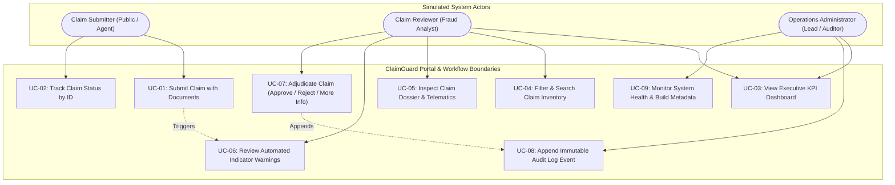
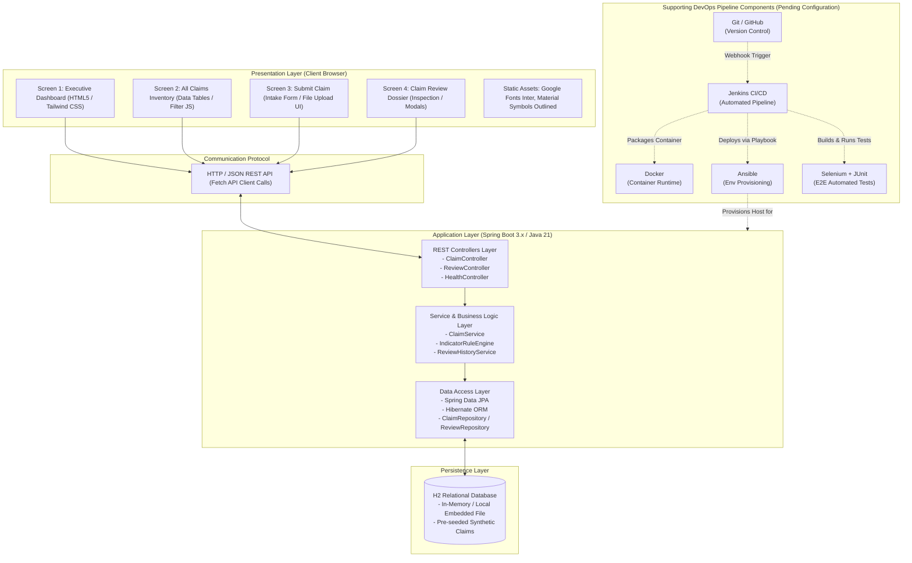
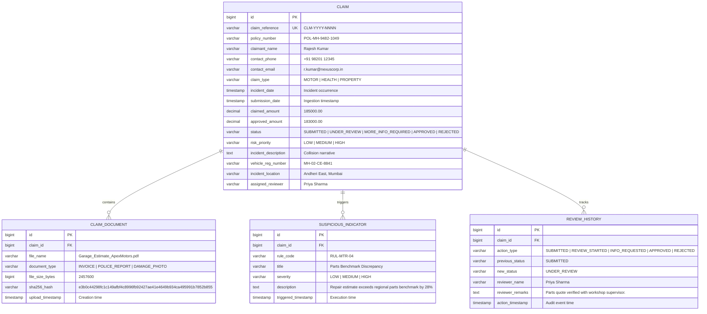
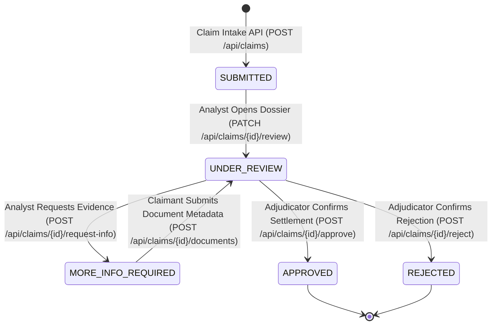

# Task 03 — Requirements, Architecture and Technology Setup

**Project Title:** Jenkins Deployment for a Claim Fraud Review Dashboard<br>
**Application Name:** ClaimGuard<br>
**Document Version:** 1.0<br>
**Date:** 2026-10-21<br>
**Author:** Raj Yadav<br>
**Status:** Proposal / Design Baseline — Pending Implementation & Manual Verification

---

## Table of Contents

1. [Section 1 — Introduction](#section-1--introduction)
2. [Section 2 — Software Requirements Specification (SRS)](#section-2--software-requirements-specification-srs)
3. [Section 3 — Use Cases](#section-3--use-cases)
4. [Section 4 — System Architecture](#section-4--system-architecture)
5. [Section 5 — Frontend Integration Strategy](#section-5--frontend-integration-strategy)
6. [Section 6 — Data Model](#section-6--data-model)
7. [Section 7 — REST API Specification](#section-7--rest-api-specification)
8. [Section 8 — Validation and Suspicious-Indicator Rules](#section-8--validation-and-suspicious-indicator-rules)
9. [Section 9 — Technology and Version Plan](#section-9--technology-and-version-plan)
10. [Section 10 — Local Development Setup](#section-10--local-development-setup)
11. [Section 11 — Proposed Project Structure](#section-11--proposed-project-structure)
12. [Section 12 — Security and Reliability](#section-12--security-and-reliability)
13. [Section 13 — Manual Verification Plan](#section-13--manual-verification-plan)
14. [Section 14 — Deliverable Mapping](#section-14--deliverable-mapping)
15. [Section 15 — Viva Preparation](#section-15--viva-preparation)

---

## Section 1 — Introduction

Task 03 bridges the strategic definition established in Task 01 (Problem Definition & Scope) and Task 02 (Agile Planning & DevOps Workflow) into a rigorous, engineering-grade technical blueprint. While Task 01 articulated the business problem of manual insurance fraud review and Task 02 structured the sprint schedules and CI/CD pipelines, Task 03 formalizes:
1. **The Exact Software Requirements Specification (SRS)** governing what ClaimGuard must process, validate, flag, and record.
2. **The Concrete System Architecture and Integration Strategy**, detailing how the visual UI export created in Google Stitch couples with an enterprise Java Spring Boot REST backend.
3. **The Relational Data Architecture and API Contract**, detailing entities, status lifecycles, and HTTP payload specifications.
4. **The Local Development Baseline and DevOps Grounding**, specifying versions, environment prerequisites, and security constraints required before source code is authored.

> **Status Notice:** Everything specified in this document represents the **planned architectural design baseline**. No application source code has been generated yet, and all runtime components, endpoints, and environment configurations remain **pending physical implementation and verification**.

---

## Section 2 — Software Requirements Specification (SRS)

### 2.1 Purpose and Scope
ClaimGuard is a specialized web-based fraud review operations console designed for insurance claims intake, automated deterministic heuristic scoring, investigator adjudication, and auditable review history tracking. Its scope spans:
- Web-based First Notice of Loss (FNOL) claim intake.
- Deterministic heuristic evaluation for suspicious indicators upon ingestion.
- Prioritized queue management and forensic claim dossier inspection.
- Human-in-the-loop adjudication workflows (`APPROVE`, `REJECT`, `REQUEST_MORE_INFO`).
- Append-only review history and audit event logging for operational compliance.
- Capture and storage of supporting document metadata (physical binary file storage is simulated and out of MVP scope).

All claim entities, claimant identities, vehicle registrations, and documents processed by ClaimGuard are strictly **synthetic test records** (Constraint C-03).

### 2.2 Target Users & Personas

| User Persona | Simulated Role | Core Operations & Permissions |
|---|---|---|
| **Claim Submitter** | Policyholder / Broker / Field Agent | Submits new claims via web portal, attaches document metadata, tracks submission status via Claim Reference ID. |
| **Claim Reviewer** | Senior Fraud Analyst / Claims Adjudicator | Reviews prioritized claims, inspects telematics/evidence, evaluates rule warnings, records findings, executes approvals/rejections, issues formal info requests. |
| **Operations Administrator** | Lead Claims Officer / DevOps Auditor | Monitors overall claim intake metrics, inspects system health endpoints, reviews immutable audit logs, oversees pipeline deployments. |

### 2.3 Functional Requirements

| ID | Module | Detailed Functional Requirement |
|---|---|---|
| **FR-01** | Claim Intake | The system shall provide an intake form capturing: Policy Number, Claimant Name, Contact (Phone, Email), Claim Type (`MOTOR`, `HEALTH`, `PROPERTY`), Incident Date/Time, Loss Location, Claimed Amount (INR), and Incident Narrative. |
| **FR-02** | Input Validation | The system shall validate mandatory fields, verify numeric amount positivity, enforce valid email/phone formats, and ensure incident dates do not occur in the future. |
| **FR-03** | Document Handling | The system shall capture supporting document metadata records (filename, document type, file size in bytes, simulated SHA-256 hash, and upload timestamp) associated with a claim record. Physical binary file content storage is simulated in the MVP and not persisted to disk. |
| **FR-04** | Indicator Evaluation | The system shall deterministically evaluate incoming claims against pre-configured heuristic rules immediately upon persistence and flag matching anomalies. |
| **FR-05** | Inventory & Filtering | The system shall expose a searchable, paginated list of claims filterable by Status, Claim Type, Risk Priority (`HIGH`, `MEDIUM`, `LOW`), and text search query. |
| **FR-06** | Claim Review Dossier | The system shall render a detailed review workspace displaying claimant particulars, vehicle/incident forensics, document preview ledger, triggered indicators, and audit timeline. |
| **FR-07** | Adjudication Actions | The system shall allow authorized reviewers to record formal findings and execute workflow transitions: `APPROVE`, `REJECT`, or `MORE_INFO_REQUIRED`. |
| **FR-08** | Audit Trail Recording | Every lifecycle state transition, rule trigger, and reviewer action shall append an immutable event entry recording timestamp, actor identity, action type, and operational remarks. |
| **FR-09** | Health Monitoring | The system shall expose a standardized health endpoint reporting backend application status, database connectivity, and build/version metadata. |

### 2.4 Non-Functional Requirements (NFR)

| ID | Category | Target Specification |
|---|---|---|
| **NFR-01** | Performance | Ingestion API response time shall be under 500 ms for synthetic claim payloads under normal local development loads. Dashboard UI load time target is ≤ 3.0 seconds for 500 synthetic records (Target SC-09). |
| **NFR-02** | Reliability | The backend service shall gracefully handle malformed JSON and database connectivity interruptions with structured RFC 7807 problem details error responses without crashing. |
| **NFR-03** | Auditability | Historical audit log entries shall be append-only; update or delete operations on review history records shall be strictly prohibited by application logic and data constraints. |
| **NFR-04** | Security | Basic input sanitization against Cross-Site Scripting (XSS) and SQL injection (via JPA parameterized queries). Zero storage of genuine Personally Identifiable Information (PII). |
| **NFR-05** | Usability | Responsive layout optimized for desktop displays (≥ 1280px width) matching the approved Google Stitch visual design specification. |
| **NFR-06** | Testability | Deterministic APIs and predictable UI component IDs (`id="claimId"`, `id="approveModal"`) enabling headless Selenium WebDriver end-to-end automation. |

### 2.5 Assumptions and Constraints

- **C-01:** Academic semester timeline constraint.
- **C-02:** Exclusively free/open-source tooling (Java 21, Spring Boot, Maven, H2, Jenkins, Docker, Ansible, Selenium).
- **C-03:** 100% synthetic mock data; zero real policyholder data.
- **C-04:** Self-contained repository execution with zero external paid third-party dependencies.
- **C-05:** H2 in-memory/file-based database for development and testing.
- **C-06:** Google Stitch frontend export must be inspected and preserved without arbitrary redesign before finalizing the integration architecture.
- **C-07:** Docker is the sole container runtime.
- **A-01 to A-07:** Local workstation has virtualization enabled; synthetic data pre-seeding is provided; rule engine is deterministic in MVP.

### 2.6 Acceptance Criteria

1. Submitting a claim with valid fields returns an HTTP `201 Created` status with an assigned `CLM-YYYY-NNNN` identifier (e.g., `CLM-2026-0001`).
2. Submitting a claim with missing mandatory fields returns an HTTP `400 Bad Request` with field-level validation messages.
3. A claim with an amount exceeding ₹1,50,000 or reporting delay > 48 hours automatically displays corresponding indicator warning badges in the review console.
4. Reviewer approval transitions claim status from `UNDER_REVIEW` to `APPROVED`, records net payout calculations, and appends an audit entry into `ReviewHistory`.
5. Accessing `/actuator/health` or `/api/health` returns HTTP `200 OK` with status `UP`.

---

## Section 3 — Use Cases

### 3.1 Actor Descriptions and Interactions

1. **Claim Submitter**:
   - Accesses the public/intake portal.
   - Enters policy number, claimant particulars, incident parameters, and damage description.
   - Attaches synthetic document metadata (garage repair estimates, police general diary extracts, damage photos).
   - Submits the claim and receives a unique tracking reference ID (`CLM-2026-0001`).
   - Checks status via search bar.

2. **Claim Reviewer**:
   - Inspects the Executive Dashboard and Priority Review Queue.
   - Opens a specific claim review dossier (e.g., `CLM-2026-0001`).
   - Analyzes automated rule evaluation signals (e.g., *Parts Benchmark Discrepancy +28%*).
   - Reviews supporting document metadata in the inline document inspection viewer.
   - Fills the mandatory verification checklist and inputs review notes.
   - Executes an adjudication action:
     - **Approve**: Computes net payout (Gross minus Deductible) and confirms release.
     - **Reject**: Selects formal rejection code and enters reason for insurance ombudsman notice.
     - **Request Information**: Selects required missing artifacts (dashcam, chassis stamp) and dispatches query.

3. **Operations Administrator**:
   - Views aggregate operational metrics (total volume, approval rate, flagged ratio, SLA adherence).
   - Audits system health, runtime build numbers (e.g., *DevOps Build v2.4.1 • Jenkins #142*), and database statistics.

### 3.2 Mermaid Use Case Flowchart


*> Note: The above diagram is an illustrative Mermaid flowchart representing user-to-system interactions and functional boundaries rather than a strict native UML use case diagram.*

---

## Section 4 — System Architecture

### 4.1 System Architecture Diagram



### 4.2 Architectural Component Responsibilities

1. **Client Browser Tier (Google Stitch HTML/CSS/JS)**:
   - Renders responsive, accessible UI views utilizing Tailwind CSS utility classes and Material Symbols.
   - Captures user input, handles client-side form field validation, and triggers asynchronous JSON HTTP requests (`fetch`).
   - Manages interactive UI states (modal flyouts, tab switches, dynamic document inspection zoom).
2. **REST Controllers Layer (`web` package)**:
   - Exposes versioned REST endpoints (`/api/claims`, `/api/reviews`, `/actuator/health`).
   - Consumes and serializes JSON Data Transfer Objects (DTOs).
   - Enforces Jakarta Bean Validation (`@Valid`, `@NotNull`, `@Min`) and translates exceptions into standard HTTP error responses.
3. **Service & Business Logic Layer (`service` package)**:
   - Orchestrates multi-step business transactions.
   - Executes the deterministic `IndicatorRuleEngine` upon claim submission.
   - Calculates financial deductions (gross claimed amount minus deductible).
   - Ensures state machine consistency (e.g., claims cannot transition directly from `SUBMITTED` to `APPROVED` without intermediate review assignment).
4. **Data Access Layer (`repository` package)**:
   - Utilizes Spring Data JPA interfaces extending `JpaRepository` to perform parameterized relational queries.
   - Handles pagination, status filtering, and entity lifecycle state management.
5. **Persistence Layer (H2 Database)**:
   - Embedded relational database running either in-memory (`jdbc:h2:mem:claimguard`) or in local file-backed mode (`jdbc:h2:file:./data/claimguard`).
   - Pre-seeded on startup with representative synthetic claim datasets via `data.sql` or `CommandLineRunner`.
6. **Supporting DevOps Components (Pending Implementation)**:
   - **Git/GitHub**: Source repository holding application code, tests, Dockerfiles, Ansible playbooks, and task documentation.
   - **Jenkins**: Orchestrates automated compile, test, container packaging, and deployment stages.
   - **Selenium WebDriver & JUnit 5**: Drives real browser sessions against the application UI to validate critical journeys.
   - **Docker**: Creates self-contained, reproducible OpenJDK runtime containers.
   - **Ansible**: Automates the provisioning of host directories, environment variables, and Docker container lifecycles.

---

## Section 5 — Frontend Integration Strategy

### 5.1 Inspection of Retrieved Stitch HTML Reference Files

Inspection of the four exported reference files in `docs/stitch-export/` yields the following baseline findings:
1. **Screen 01 (`screen-01-executive-dashboard.html`)**: Complete desktop dashboard layout featuring SVG metric charts, distribution donuts, and high-priority review listings.
2. **Screen 02 (`screen-02-all-claims.html`)**: Rich claims directory table with active/inactive filter pill bars, search box, pagination controls, multi-select checkboxes, and state emulators (empty, loading, error).
3. **Screen 03 (`screen-03-submit-claim.html`)**: Comprehensive 3-phase claim registration form with drag-and-drop document upload zones, live suspicious risk gauge, and modal preview dialog.
4. **Screen 04 (`screen-04-claim-details-review.html`)**: Two-column forensic console (60/40 split) featuring claimant details, document viewer, audit timeline spine, rule evaluation cards, review notes, and three interactive modals (`approveModal`, `rejectModal`, `requestInfoModal`).

### 5.2 Framework & Dependency Analysis

- **Styling Architecture**: All four files rely on the Tailwind CSS Play CDN (`<script src="https://cdn.tailwindcss.com"></script>`) coupled with a custom inline `<script id="tailwind-config">` block extending colors (`primary`, `surface-container-*`, `error`), spacing, and typography scales.
- **Web Typography & Icons**: Relies on external Google Fonts CDN links for `Inter` (`family=Inter:wght@100..900`) and `Material Symbols Outlined`.
- **Remote Image Assets**: References external Google Cloud usercontent URLs (`https://lh3.googleusercontent.com/...`) for the ClaimGuard logo and reviewer profile avatars.
- **Navigation & Routing**: Navigation links currently use inert anchor targets (`href="#"` or `data-path="dashboard"`).
- **Interaction Model**: Interactions are simulated with vanilla DOM manipulation (e.g., `document.getElementById('approveModal').classList.remove('hidden')`). No backend data binding currently exists.

### 5.3 Frontend Serving Architecture Options

In accordance with **Constraint C-06** (*"The Google Stitch frontend design must be exported and inspected before a final decision is made on the integration approach"*), we evaluate the three viable integration patterns:

| Dimension | Option 1: Full Server-Side Rendering (Thymeleaf) | Option 2: Spring Boot Static Resource Serving + Fetch API (Recommended) | Option 3: Decoupled Single-Page App (Node/React/Nginx) |
|---|---|---|---|
| **Mechanism** | Convert HTML into Thymeleaf templates (`src/main/resources/templates/`) using `th:text`, `th:each`, `th:action`. | Serve original HTML files directly from `src/main/resources/static/` and attach lightweight JavaScript `fetch()` calls to consume REST endpoints. | Re-write UI into React/Vue/Angular and host on separate Node/Nginx server. |
| **Fidelity to Stitch Design** | Moderate risk of styling discrepancies when breaking monolithic pages into fragments. | **Highest.** Preserves 100% of the original Stitch HTML, Tailwind config, and SVG graphics without alteration. | Low. Requires complete frontend component re-write. |
| **Development Complexity** | High. Requires writing Spring MVC model controllers and extensive Thymeleaf attribute replacements. | **Low / Optimal.** Keeps frontend HTML/CSS cleanly decoupled from backend Java controllers. | Very High. Overkill for an academic DevOps project with strict delivery timelines. |
| **Selenium Testability** | Good. | **Excellent.** All existing HTML IDs (`#reviewNotes`, `#approveModal`) and structures remain intact. | Good, but requires handling asynchronous SPA hydration. |
| **Pipeline Simplicity** | Single JAR build via Maven. | **Single JAR build via Maven.** Maven packages static assets inside the standard executable JAR. | Requires multi-stage builds (npm + Maven) and multiple containers. |

### 5.4 Recommended Approach & Architectural Decision

**Decision:** Adopt **Option 2 — Spring Boot Static Resource Serving with Asynchronous REST Communication (`Fetch API`)**.

**Implementation Blueprint:**
1. The four Stitch HTML files will be copied into `src/main/resources/static/` as `index.html` (Dashboard), `claims.html`, `submit.html`, and `review.html`.
2. Clean, modular client-side JavaScript controllers (e.g., `js/claims-api.js`, `js/review-api.js`) will attach event listeners to existing form buttons (`id="submitClaimBtn"`, `id="confirmApproveBtn"`).
3. The JavaScript will serialize user input to JSON, dispatch HTTP requests to Spring Boot REST endpoints (`/api/claims`), and dynamically render API responses into existing table and card DOM elements.
4. **Logo Localization Decision (Approved Planned Implementation for Task 04/05):** In the raw Stitch HTML export, the ClaimGuard logo is linked via an external Google-hosted usercontent URL. As an approved architectural decision, a local SVG version of the logo (`claimguard-logo.svg`) will be introduced under `src/main/resources/static/assets/` during the static resource setup in Task 04/05. This ensures that the application renders reliably when built and run in offline, air-gapped, or isolated Docker container environments without altering the preserved Stitch reference exports in `docs/stitch-export/` or downloading assets in Task 03.

---

## Section 6 — Data Model

### 6.1 Relational Schema & Entity Specifications

The relational schema centers on the `Claim` entity, supported by child entities `ClaimDocument`, `SuspiciousIndicator`, and `ReviewHistory`.



### 6.2 Entity Lifecycle & Status State Machine

The workflow status is strictly distinguished from suspicious indicator severity:
- **Claim Workflow Status** (`status`): Represents the administrative state of the claim (`SUBMITTED` ➔ `UNDER_REVIEW` ➔ `MORE_INFO_REQUIRED` ➔ `APPROVED` or `REJECTED`).
- **Risk Severity Priority** (`risk_priority`): Represents the cumulative risk evaluated by heuristic rules (`LOW`, `MEDIUM`, `HIGH`). A `HIGH` risk claim can still ultimately be `APPROVED` after rigorous investigation.



### 6.3 Review History & State-Transition Consistency

Every state transition and reviewer action appends an audit event entry to `REVIEW_HISTORY`:
- **State Transition Triggers**:
  - `SUBMITTED` (initial claim intake via `POST /api/claims`)
  - `UNDER_REVIEW` (investigator starts review via `PATCH /api/claims/{id}/review` or claimant supplies requested document metadata via `POST /api/claims/{id}/documents`)
  - `MORE_INFO_REQUIRED` (investigator dispatches query via `POST /api/claims/{id}/request-info`)
  - `APPROVED` (investigator authorizes settlement via `POST /api/claims/{id}/approve`)
  - `REJECTED` (investigator records rejection notice via `POST /api/claims/{id}/reject`)
- **Primary Key**: `id` (Auto-increment BigInt).
- **Foreign Key**: `claim_id` referencing `CLAIM(id)`.
- **Relational Integrity & Immutability**: `ReviewHistory` records are append-only. The service layer exposes no `update` or `delete` methods, and database-level foreign key constraints use `ON DELETE RESTRICT` to protect audit entries from cascading deletions.
- **Storage Layer Clarification**: Immutability is enforced through application logic, strict REST API constraints, and relational schema integrity. The database is not claimed to be cryptographically tamper-proof at the physical storage layer.

---

## Section 7 — REST API Specification

> **Notice:** The following endpoints define the proposed API contract to be implemented in Spring Boot. They do not exist yet in runtime.

### 7.1 Proposed API Endpoints Contract

| Method | Endpoint | Purpose | Request Parameters / Body | Response Status & Payload | Validation & Error Cases |
|---|---|---|---|---|---|
| `GET` | `/actuator/health` | System health probe | None | `200 OK`<br>`{"status":"UP","components":{...}}` | `503 Service Unavailable` if database down |
| `POST` | `/api/claims` | Ingest new claim | JSON `CreateClaimRequest` (claimant, policy, amount, incident details) | `201 Created`<br>`{"id":1,"claimReference":"CLM-2026-0001",...}` | `400 Bad Request` on missing fields, future dates, negative amounts |
| `GET` | `/api/claims` | List/search claims | Query params: `page`, `size`, `status`, `risk`, `search` | `200 OK`<br>`{"content":[...],"totalElements":45,"totalPages":5}` | `400 Bad Request` on invalid pagination parameters |
| `GET` | `/api/claims/{id}` | Retrieve claim dossier by internal ID | Path parameter: `id` (numeric primary key, e.g., `1`) | `200 OK`<br>Full `ClaimDetailDTO` (claimant, indicators, history) | `404 Not Found` if numeric ID does not exist |
| `GET` | `/api/claims/reference/{claimReference}` | Retrieve claim dossier by business reference | Path parameter: `claimReference` (string, e.g., `CLM-2026-0001`) | `200 OK`<br>Full `ClaimDetailDTO` (claimant, indicators, history) | `404 Not Found` if claim reference does not exist |
| `GET` | `/api/claims/{id}/indicators` | Retrieve flagged rules | Path: `id` (numeric primary key) | `200 OK`<br>`[{"ruleCode":"RUL-MTR-04","severity":"MEDIUM",...}]` | `404 Not Found` |
| `PATCH` | `/api/claims/{id}/review` | Start review / assign | Path: `id`, Body: `{"reviewerName":"Priya Sharma"}` | `200 OK`<br>`{"status":"UNDER_REVIEW","assignedReviewer":"Priya Sharma"}` | `404 Not Found`, `409 Conflict` if claim is already resolved |
| `POST` | `/api/claims/{id}/documents` | Attach supporting document metadata | Path: `id`, Body: `{"fileName":"...","documentType":"...","fileSizeBytes":2457600}` | `201 Created`<br>`{"documentId":1,"uploadTimestamp":"..."}` | `400 Bad Request` on invalid metadata, `404 Not Found`. Appends audit event and transitions `MORE_INFO_REQUIRED` to `UNDER_REVIEW`. |
| `POST` | `/api/claims/{id}/approve` | Approve settlement | Path: `id`, Body: `{"remarks":"...","deductible":2000.00}` | `200 OK`<br>`{"status":"APPROVED","approvedAmount":183000.00}` | `400 Bad Request` if mandatory remarks missing, `409 Conflict` |
| `POST` | `/api/claims/{id}/reject` | Reject claim | Path: `id`, Body: `{"reasonCode":"mismatch","remarks":"..."}` | `200 OK`<br>`{"status":"REJECTED","reasonCode":"mismatch"}` | `400 Bad Request` if reason code omitted, `409 Conflict` |
| `POST` | `/api/claims/{id}/request-info` | Request more evidence | Path: `id`, Body: `{"requestedDocTypes":[...],"query":"..."}` | `200 OK`<br>`{"status":"MORE_INFO_REQUIRED"}` | `400 Bad Request` if query empty |
| `GET` | `/api/claims/{id}/history` | Retrieve audit trail | Path: `id` (numeric primary key) | `200 OK`<br>`[{"actionType":"SUBMITTED",...},{"actionType":"APPROVED",...}]` | `404 Not Found` |

### 7.2 Standard Error Response Payload (RFC 7807)

```json
{
  "type": "about:blank",
  "title": "Validation Failed",
  "status": 400,
  "detail": "Invalid claim submission payload.",
  "timestamp": "2026-10-21T19:30:00Z",
  "fieldErrors": [
    {
      "field": "claimAmount",
      "message": "Claim amount must be greater than zero."
    },
    {
      "field": "incidentDate",
      "message": "Incident date cannot be in the future."
    }
  ]
}
```

---

## Section 8 — Validation and Suspicious-Indicator Rules

### 8.1 Conceptual Distinction

To ensure clarity for implementation and academic assessment, three concepts are strictly distinguished:

```
[ Incoming User Input ]
        │
        ▼
1. Validation Failure (HTTP 400 Rejection)
   - Checks structural and data type integrity (mandatory fields, formats, positive numbers, non-future dates).
   - If validation fails, the claim is NOT saved in the database.
        │ (Passed)
        ▼
2. Suspicious Indicators (Heuristic Signals)
   - Evaluated by the rule engine immediately after valid claim persistence.
   - Triggers warning flags (e.g., benchmark discrepancy, filing delay, threshold).
   - DOES NOT reject or halt the claim. Routes claim to high-priority review queue.
        │
        ▼
3. Human Review Decision (Final Adjudication)
   - Executed by an authorized investigator after inspecting evidence and corroborating facts.
   - Results in formal APPROVE, REJECT, or MORE_INFO_REQUIRED status transitions.
```

### 8.2 Deterministic Suspicious-Indicator Rules

| Rule Code | Rule Title | Evaluation Logic | Severity | Flag Description |
|---|---|---|---|---|
| **RUL-AMT-01** | High Value Claim Threshold | `claimAmount >= 150000.00 INR` | `MEDIUM` | "Claim value exceeds standard threshold of ₹1,50,000; mandatory secondary supervisor sign-off required." |
| **RUL-TIM-01** | Delayed Incident Reporting | `daysBetween(incidentDate, submissionDate) > 2` | `LOW` | "Incident reported 4 days post occurrence. Baseline window is 48 hours for motor collisions." |
| **RUL-MTR-04** | Parts Benchmark Discrepancy | `claimAmount > regionalCatalogBenchmark * 1.25` | `MEDIUM` | "Repair estimate exceeds regional parts benchmark by 28% for front assembly." |
| **RUL-DUP-01** | Duplicate Claim Reference | `countClaimsByPolicyAndDate(policyNumber, incidentDate) > 1` | `HIGH` | "Multiple active claim submissions detected for the same policy number on this incident date." |
| **RUL-DOC-02** | Missing Mandatory Document | `countAttachedDocuments(claimId) == 0` | `HIGH` | "Claim submitted without mandatory garage repair estimate or incident report." |

---

## Section 9 — Technology and Version Plan

### 9.1 Planned Technology Stack

| Technology | Proposed Version | Role & Responsibility | Installation & Verification Status |
|---|---|---|---|
| **Java Development Kit (JDK)** | OpenJDK 21 (LTS) | Core backend runtime and language platform. | Pending verification (`java -version`) |
| **Spring Boot Framework** | 3.3.x (or latest 3.x) | Web REST APIs, Dependency Injection, validation, and embedded Tomcat. | Pending initialization via Maven |
| **Apache Maven** | 3.9.x + Maven Wrapper (`mvnw`) | Dependency management, build automation, reproducible pipeline compilation. | Pending verification (`mvn -v`) |
| **H2 Database** | 2.2.x | Relational in-memory and file-based database for development and testing. | Pending runtime inclusion in `pom.xml` |
| **Git & GitHub** | Git 2.4x / GitHub Cloud | Distributed version control, branch management, and Jenkins webhook integration. | Pending verification (`git --version`) |
| **Jenkins** | 2.440+ LTS | Automation server orchestrating CI/CD build, test, and deployment jobs. | Pending verification (`jenkins --version`) |
| **Selenium WebDriver** | 4.x + JUnit 5 | Headless end-to-end browser automation validating 5 core user journeys. | Pending inclusion in `pom.xml` test scope |
| **Docker Engine** | 26.x+ (Docker Desktop) | Container packaging to guarantee identical execution environments across nodes. | Pending virtualization check (`docker --version`) |
| **Ansible** | 2.15+ (Core) | Declarative configuration management and host provisioning automation. | Pending WSL/Linux check (`ansible --version`) |

### 9.2 Rationale for Choosing Apache Maven

Maven was selected over Gradle for the following specific reasons:
1. **Industry-Standard Stability:** Declarative XML model (`pom.xml`) enforces strict convention-over-configuration, reducing build script fragility.
2. **Jenkins Ecosystem Integration:** The native Jenkins Maven integration plugin provides automated test parsing, artifact archiving, and POM-driven versioning out of the box.
3. **Maven Wrapper (`mvnw`):** Guarantees that any developer, CI server, or grading assessor can execute identical builds without needing a pre-installed local Maven binary.

---

## Section 10 — Local Development Setup (Windows 10)

### 10.1 Required Software Checklist

Before starting implementation, the developer must verify that the required runtimes are installed.

> **Execution Notice:** The following commands are documented for manual verification by the developer. **Do not execute them automatically.**

```powershell
# 1. Verify Java 21 LTS
java -version
# Expected: openjdk version "21.x.x"

# 2. Verify Apache Maven
mvn -version
# Expected: Apache Maven 3.9.x

# 3. Verify Git
git --version
# Expected: git version 2.x.x

# 4. Verify Docker (Optional for Task 3, mandatory for Task 6)
docker --version
# Expected: Docker version 26.x.x or higher
```

### 10.2 Windows 10 Virtualization & Docker Warning

> **Caution:** Do not assume Docker Desktop will run immediately on Windows 10. Docker Desktop requires:
> 1. Hardware virtualization enabled in BIOS/UEFI (Intel VT-x / AMD-V).
> 2. Windows 10 64-bit (Build 19041 or higher).
> 3. WSL 2 (Windows Subsystem for Linux 2) installed and updated (`wsl --update`).
> 4. Minimum 8 GB RAM (16 GB recommended to support Jenkins + Docker + IDE simultaneously).

### 10.3 Configuration Requirements (`application.properties`)

The proposed local development configuration:

```properties
# Spring Application Metadata
spring.application.name=claimguard-dashboard
server.port=8080

# H2 Database Local Development Configuration
spring.datasource.url=jdbc:h2:mem:claimguard;DB_CLOSE_DELAY=-1;DB_CLOSE_ON_EXIT=FALSE
spring.datasource.driverClassName=org.h2.Driver
spring.datasource.username=sa
spring.datasource.password=

# JPA / Hibernate DDL and SQL Logging
spring.jpa.database-platform=org.hibernate.dialect.H2Dialect
spring.jpa.hibernate.ddl-auto=update
spring.jpa.show-sql=true
spring.jpa.properties.hibernate.format_sql=true

# H2 Web Console (Local Development & Debugging Only - MUST be disabled in deployment)
spring.h2.console.enabled=true
spring.h2.console.path=/h2-console

# Spring Boot Actuator Health Monitoring (Local Development - Expose minimal details in deployment)
management.endpoints.web.exposure.include=health,info
management.endpoint.health.show-details=always
```

> **Deployment Security Warning:** The H2 web console (`spring.h2.console.enabled=true`) and detailed actuator health output (`management.endpoint.health.show-details=always`) are strictly intended for local development and debugging on an isolated workstation. In deployed environments (such as Docker containers or Jenkins-deployed hosts), the H2 console must be explicitly disabled (`spring.h2.console.enabled=false`), and actuator endpoints must be restricted (`show-details=never` or secured via access controls) to prevent unauthorized database access or exposure of internal infrastructure metadata.

### 10.4 Proposed Startup & Manual Verification Sequence

1. Open a PowerShell terminal in the repository root.
2. Build and package the project:
   ```powershell
   .\mvnw clean package
   ```
3. Run the Spring Boot application locally:
   ```powershell
   .\mvnw spring-boot:run
   ```
4. Open a browser and verify the endpoints:
   - Dashboard: `http://localhost:8080/`
   - Health Check: `http://localhost:8080/actuator/health`
   - H2 Console: `http://localhost:8080/h2-console`

---

## Section 11 — Proposed Project Structure

The proposed project layout cleanly separates the preserved Stitch visual specifications from the Java backend code and static web assets:

```
Claim-Fraud-Review-Dashboard/
│
├── .mvn/                               # Maven Wrapper executable binaries & settings
│   └── wrapper/
│       ├── maven-wrapper.jar
│       └── maven-wrapper.properties
├── mvnw                                # Maven Wrapper shell script (Linux/macOS)
├── mvnw.cmd                            # Maven Wrapper batch script (Windows)
├── pom.xml                             # Maven Project Object Model (Dependencies & Plugins)
│
├── docs/                               # Project Task Documentation (Version-Controlled)
│   ├── task-01-problem-definition.md   # Task 1: Problem Definition & Scope (Approved)
│   ├── task-02-agile-planning.md       # Task 2: Agile Planning & DevOps Workflow (Approved)
│   ├── task-03-requirements-architecture.md # Task 3: Requirements & Architecture (This Document)
│   └── stitch-export/                  # Preserved Raw Google Stitch Exports (Read-Only Ground Truth)
│       ├── README.md                   # Stitch export manifest, IDs, and limitations
│       ├── screen-01-executive-dashboard.html
│       ├── screen-02-all-claims.html
│       ├── screen-03-submit-claim.html
│       └── screen-04-claim-details-review.html
│
└── src/                                # Application Source Code (PROPOSED — Not yet created)
    ├── main/
    │   ├── java/
    │   │   └── com/claimguard/dashboard/
    │   │       ├── ClaimGuardApplication.java       # Spring Boot main entry point
    │   │       ├── config/                          # Security, WebMvc, and App Config
    │   │       ├── controller/                      # REST API Controllers (Claim, Review, Health)
    │   │       ├── dto/                             # Data Transfer Objects & API Payloads
    │   │       ├── entity/                          # JPA Relational Entities (Claim, ReviewHistory)
    │   │       ├── exception/                       # Global Exception Handler (@ControllerAdvice)
    │   │       ├── repository/                     # Spring Data JPA Repositories
    │   │       ├── rules/                           # Deterministic Indicator Rules Engine
    │   │       └── service/                         # Transactional Business Services
    │   │
    │   └── resources/
    │       ├── application.properties               # Local environment configuration
    │       ├── data.sql                             # Synthetic claim seed records
    │       └── static/                              # Static Frontend Web Assets (Based on Stitch)
    │           ├── index.html                       # Executive Dashboard
    │           ├── claims.html                      # All Claims Inventory
    │           ├── submit.html                      # Claim Intake Portal
    │           ├── review.html                      # Claim Dossier Review Workspace
    │           ├── css/                             # Custom localized styles
    │           └── js/                              # Vanilla JS API Client & UI Event Controllers
    │
    └── test/
        └── java/
            └── com/claimguard/dashboard/
                ├── unit/                            # JUnit 5 Unit Tests (Rules, Services)
                ├── integration/                     # SpringBootTest MockMvc API Integration Tests
                └── e2e/                             # Selenium WebDriver Browser Journey Tests
```

---

## Section 12 — Security and Reliability

### 12.1 Synthetic Data Policy & Privacy
- Zero production or real policyholder information will be gathered, transmitted, or stored.
- All names (`Rajesh Kumar`), phone numbers (`+91 98201...`), Aadhaar IDs (`IN-KYC-99120`), and vehicle plates (`MH-02-CE-8841`) are synthetic mock strings.

### 12.2 Input Validation & Injection Mitigation
- Strict Java Bean Validation (`@NotBlank`, `@Size(max=100)`, `@Positive`, `@PastOrPresent`) on all DTO parameters.
- Parameterized SQL queries enforced exclusively through Spring Data JPA / Hibernate; no raw string concatenation in SQL queries.
- HTML sanitization applied to user narrative textareas before rendering to eliminate Cross-Site Scripting (XSS).

### 12.3 Document Handling Scope and Safe Metadata Restrictions
- **MVP Document Scope:** In the MVP release, ClaimGuard captures and persists **document metadata only** (filename, document type, file size in bytes, upload timestamp, and simulated SHA-256 integrity hash).
- **No Physical Binary Storage:** The application does not store binary file payloads to the local filesystem, database BLOBs, or cloud object stores (such as S3).
- **Inspection UI:** The document inspection viewer renders pre-configured synthetic demo documents to illustrate investigator review workflows safely, avoiding the risks and overhead of unmanaged binary file storage on disk.
- **Upload Constraints:** Input metadata is constrained to permitted extensions only (`.pdf`, `.jpg`, `.png`) with a maximum declared file size limit of 5 MB per document. Executable extensions (`.exe`, `.bat`, `.sh`, `.jar`) are strictly rejected.

### 12.4 Audit Log Immutability & Relational Integrity
- The `ReviewHistory` entity is strictly append-only at the application and service tier.
- The service layer exposes no `update` or `delete` methods for review entries.
- Every state transition and reviewer action records an automatic system timestamp (`actionTimestamp`), action type, reviewer name, and remarks.
- Relational foreign-key constraints apply `ON DELETE RESTRICT` to protect audit records against cascading deletion.
- **Storage Layer Clarification:** Immutability is enforced through application logic, strict REST API constraints, and relational schema integrity. The database is not claimed to be cryptographically tamper-proof at the physical storage layer.

### 12.5 Database Persistence & Limitations of H2
- In-memory H2 (`jdbc:h2:mem:...`) resets on application shutdown.
- For local development persistence across server restarts, the application will support switching to file-backed H2 (`jdbc:h2:file:./data/claimguard`) via profile configuration (`spring.profiles.active=local-persist`).
- Synthetic seed records are automatically re-populated from `data.sql` if the database is reset.

### 12.6 Logging & Secrets Hygiene
- Logging implemented using SLF4J / Logback with structured formatting.
- Passwords, keys, and session tokens are never printed to console logs.
- Sensitive environment configurations (e.g., database credentials or Jenkins API tokens) will be managed via environment variables rather than hardcoded in the codebase.

---

## Section 13 — Manual Verification Plan

Once implementation begins in subsequent tasks, the following verification test matrix must be executed:

| Test ID | Verification Scope | Target Expected Behavior | Execution Status |
|---|---|---|---|
| **VT-01** | Frontend Serving | Accessing `http://localhost:8080/` loads the Executive Dashboard with complete Stitch visual styling. | **Not Run (Pending Implementation)** |
| **VT-02** | Health Endpoint | `GET /actuator/health` returns HTTP 200 with `{"status":"UP"}`. | **Not Run (Pending Implementation)** |
| **VT-03** | Claim Intake (Valid) | Submitting valid claim form sends `POST /api/claims` and returns HTTP 201 with generated Claim ID. | **Not Run (Pending Implementation)** |
| **VT-04** | Claim Intake (Invalid) | Submitting empty form returns HTTP 400 with highlighted inline validation error messages. | **Not Run (Pending Implementation)** |
| **VT-05** | Indicator Trigger | Ingesting claim > ₹1,50,000 flags rule `RUL-AMT-01` and marks priority as `MEDIUM`/`HIGH`. | **Not Run (Pending Implementation)** |
| **VT-06** | Claim Review Details | Opening `review.html?id=1` renders claimant dossier, attachments, and triggered rules. | **Not Run (Pending Implementation)** |
| **VT-07** | Adjudication (Approve) | Reviewer clicking "Confirm Approval" transitions status to `APPROVED` and records net payout. | **Not Run (Pending Implementation)** |
| **VT-08** | Adjudication (Reject) | Reviewer clicking "Confirm Rejection" transitions status to `REJECTED` and records reason code. | **Not Run (Pending Implementation)** |
| **VT-09** | Audit Trail Verification | Querying `/api/claims/{id}/history` returns an ordered, timestamped log of all transitions. | **Not Run (Pending Implementation)** |
| **VT-10** | H2 Persistence Check | Verifying that seed claims exist upon initial startup in the H2 Web Console. | **Not Run (Pending Implementation)** |

---

## Section 14 — Deliverable Mapping

This document satisfies the official deliverables mandated for Task 03 of the DevOps project curriculum:

| Official Task 3 Deliverable | Document Section | Status | Notes |
|---|---|---|---|
| **Software Requirements Specification (SRS)** | [Section 2](#section-2--software-requirements-specification-srs) & [Section 8](#section-8--validation-and-suspicious-indicator-rules) | Fully Documented | Functional, non-functional, assumptions, constraints, and rule definitions. |
| **Use Case Diagrams & Interaction Flows** | [Section 3](#section-3--use-cases) | Fully Documented | Detailed actor personas, interaction narratives, and Mermaid flowchart. |
| **System Architecture Diagram** | [Section 4](#section-4--system-architecture) | Fully Documented | End-to-end multi-tier architecture with supporting DevOps components. |
| **Data Model & REST API Specifications** | [Section 6](#section-6--data-model) & [Section 7](#section-7--rest-api-specification) | Fully Documented | ER diagrams, entity schemas, status lifecycles, and RFC 7807 API contracts. |
| **Frontend Integration Strategy** | [Section 5](#section-5--frontend-integration-strategy) | Fully Documented | Inspection of 4 Stitch screens, CDN dependencies, and Option 2 adoption. |
| **Working Local Development Setup** | [Section 10](#section-10--local-development-setup) | **Design Plan Complete; Physical Setup Incomplete** | Documented setup commands and prerequisites. Working local setup remains incomplete until code is created and executed in Task 4/5. |

---

## Section 15 — Viva Preparation

### 15.1 Plain-Language Architecture Breakdown

- **What is ClaimGuard?**<br>
  It is a centralized web dashboard that helps insurance fraud analysts review flagged claims faster. It takes claim data, applies automated heuristic rules to highlight potential red flags, and provides an auditable screen where human analysts make the final approval or rejection decision.
- **How do the frontend and backend talk to each other?**<br>
  The frontend consists of HTML/CSS/JavaScript pages based on designs created in Google Stitch. When a user clicks a button (e.g., "Submit Claim"), JavaScript sends an HTTP request carrying JSON data to the Spring Boot REST backend (`POST /api/claims`). The backend processes the request and returns a JSON response, which the JavaScript renders into the page without needing a full-page reload.
- **Why use Spring Boot and Maven?**<br>
  Spring Boot provides production-grade capabilities (embedded Tomcat, automated configuration, validation, security) out of the box with minimal boilerplate. Maven provides standardized dependency management, consistent project directory structures, and a Maven Wrapper (`mvnw`) that ensures repeatable builds across any computer or Jenkins build agent.
- **What is H2 and why are we using it?**<br>
  H2 is a lightweight, zero-configuration Java SQL database. It runs directly inside the application process in memory or as a local file, making it ideal for academic development, automated testing, and CI/CD pipelines without needing to install an external database server like MySQL or PostgreSQL.
- **What is the difference between planned and implemented functionality right now?**<br>
  Right now, the project has completed Problem Definition (Task 1), Agile Planning (Task 2), Stitch Frontend Screen Design & Export, and System Requirements Architecture (Task 3). All endpoints, databases, controllers, and CI/CD pipelines described here are **planned architectural specifications**. They will be physically implemented in Task 4 (Backend), Task 5 (Frontend Integration), and subsequent DevOps tasks.

### 15.2 Likely Viva Questions and Model Answers

#### Q1: What is the primary problem ClaimGuard solves?
> **Answer:** Traditional insurance claim review is manual, slow, prone to human inconsistency, and lacks transparent auditability. ClaimGuard provides a centralized web dashboard that ingests claims, runs deterministic heuristic rules to flag anomalies immediately, and provides human adjudicators with an evidence dossier to approve, reject, or request information with an auditable append-only review history.

#### Q2: Why did you choose a REST API architecture instead of traditional server-side rendering with JSP or Thymeleaf?
> **Answer:** Decoupling the frontend from the backend via REST APIs allows the Google Stitch HTML/CSS interface to remain clean and unmodified while communicating via standard JSON. It also allows backend services to be tested independently via API integration tests and makes the application modular and ready for future multi-client expansions (such as mobile or third-party webhooks).

#### Q3: What is the difference between an input validation failure and a suspicious indicator?
> **Answer:** Input validation checks structural data validity (e.g., missing mandatory fields, negative amounts, future dates). If validation fails, the API rejects the request with HTTP 400 and the claim is never saved. A suspicious indicator is a business rule (e.g., claim > ₹1,50,000 or reporting delay > 48h) evaluated on a valid, saved claim. It does not reject the claim; it merely flags it for prioritized human scrutiny.

#### Q4: Why is an append-only review history necessary in insurance claim processing?
> **Answer:** Insurance decisions carry legal, financial, and regulatory implications. An append-only review history ensures that every action, status transition, timestamp, and analyst remark is permanently recorded as an immutable log at the application layer. This provides transparent tracking for management and statutory insurance ombudsman audits, without falsely claiming cryptographic storage-level immutability.

#### Q5: Why is H2 suitable for this project, and what are its limitations?
> **Answer:** H2 requires zero external installation, starts instantly, and can be easily seeded with synthetic data, which is ideal for automated CI/CD pipelines and unit/integration testing. Its limitation is that in-memory mode loses all data when the application stops. For development persistence, file-based H2 mode can be enabled, and in a real production environment, it would be replaced with a robust enterprise database like PostgreSQL.

#### Q6: How does Constraint C-06 affect your frontend implementation?
> **Answer:** Constraint C-06 required us to export and inspect the Google Stitch frontend design before committing to an integration approach. Inspection revealed that Stitch produced complete standalone HTML files styled with Tailwind CSS Play CDN. We therefore chose to serve these static files directly from Spring Boot and use lightweight Fetch API calls, preserving 100% of the design fidelity without unnecessary template conversions.

#### Q7: Why did you select Maven instead of Gradle?
> **Answer:** Maven relies on declarative XML configuration (`pom.xml`) with strict, established conventions. It integrates natively with Jenkins CI plugins without extra configuration and includes the Maven Wrapper (`mvnw`), ensuring that the build behaves identically on Windows, Linux, and Jenkins CI nodes.

#### Q8: What role will Selenium play in the DevOps pipeline?
> **Answer:** Selenium WebDriver will automate end-to-end user journeys against a running instance of the application in a headless browser (e.g., submitting a claim, verifying UI error states, approving a claim). It verifies that all components (HTML, JavaScript, Spring Boot REST controllers, and H2) work together seamlessly before Jenkins promotes the build.

#### Q9: What is the significance of the Maven Wrapper (`mvnw`)?
> **Answer:** The Maven Wrapper downloads and uses a project-specific version of Maven automatically if it is not present on the host system. This eliminates the "works on my machine" problem and prevents build failures caused by mismatched local Maven versions on different developer machines or CI build slaves.

#### Q10: How will the system prevent accidental exposure of sensitive policyholder data?
> **Answer:** By adhering to Constraint C-03, the project uses 100% synthetic mock data generated specifically for demonstration purposes. No real names, policies, or KYC credentials will ever enter the system. Furthermore, logging hygiene prevents sensitive payloads from appearing in console or application logs.

#### Q11: What HTTP status codes does your REST API use and why?
> **Answer:** We adhere to standard REST conventions: `200 OK` for successful retrievals and state updates, `201 Created` for new claim submissions, `400 Bad Request` for invalid input payloads, `404 Not Found` when a requested claim ID does not exist, `409 Conflict` if an action cannot be performed on the claim's current state, and `500 Internal Server Error` for unhandled runtime exceptions.

#### Q12: How will Docker and Ansible be used once implementation progresses to later tasks?
> **Answer:** Docker will package the compiled Spring Boot application and its OpenJDK runtime into a lightweight, portable container image. Ansible will be used in subsequent tasks to automate environment provisioning—configuring target directories, setting environment variables, and orchestrating container deployment—ensuring repeatable, infrastructure-as-code deployments.
