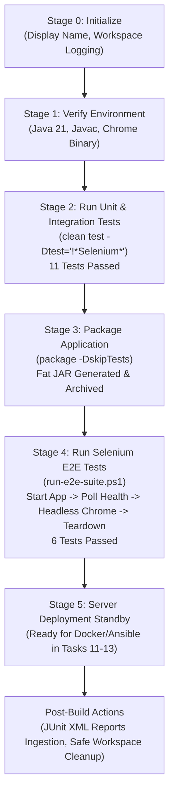
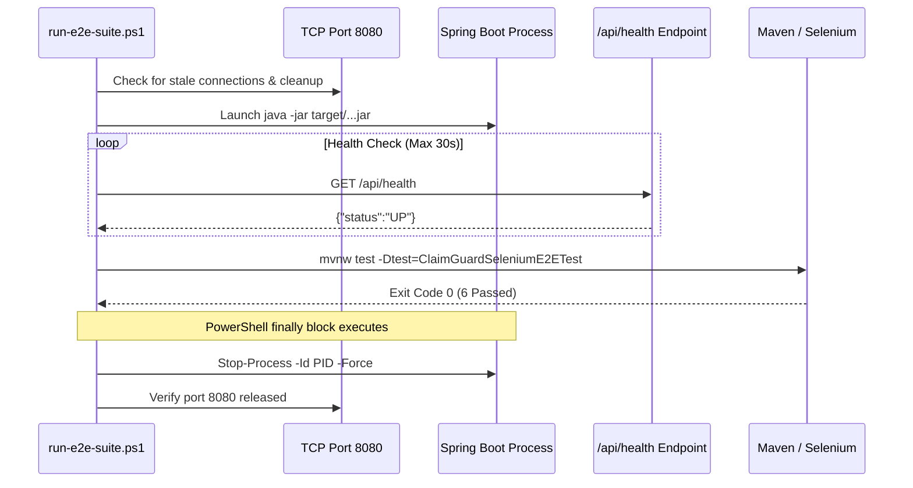

# Task 10 — Continuous Testing in Jenkins

**Project:** ClaimGuard — Claim Fraud Review Dashboard  
**Assignment Module:** Jenkins Deployment for a Claim Fraud Review Dashboard  
**Author:** Raj Yadav  
**Date:** 2026-10-22  
**Branch:** `main`  
**CI/CD Pipeline:** Declarative Pipeline (`Jenkinsfile`)  
**Jenkins Target Instance:** Jenkins 2.580.1 LTS (`http://localhost:8081`)  
**JDK Version:** OpenJDK 21 LTS (`C:\Program Files\Eclipse Adoptium\jdk-21.0.12.101-hotspot`)  
**Browser Engine:** Google Chrome Headless 156.0.8078.48 via Selenium Manager  

---

## 1. Executive Summary & Objectives

Continuous Testing in modern CI/CD ensures that software changes are automatically validated against both low-level unit expectations and real user-facing browser workflows before artifacts are cleared for staging or production deployment.

### 1.1 Core Objectives for Task 10
1. **Automated End-to-End Test Integration:** Integrate the 6 Selenium WebDriver browser tests developed in Task 9 into the Jenkins Declarative Pipeline.
2. **Suite Separation & Reporting Accuracy:** Isolate fast, in-memory unit and MockMvc integration tests (11 tests) from slower browser-driven E2E tests (6 tests) so that failures are localized and distinct JUnit test reports are generated.
3. **Controlled Application Lifecycle:** Automatically spin up the Spring Boot application from the packaged executable JAR, poll the `/api/health` endpoint until readiness is confirmed, execute the browser test suite, and guarantee reliable termination and port release even if assertions fail.
4. **Browser & Environment Strategy for Windows CI:** Explicitly account for Windows desktop isolation (Session 0) when Jenkins operates as a Windows Service, enforcing headless browser execution (`--headless=new`, `--no-sandbox`, `--disable-gpu`) and resolving ChromeDriver via Selenium Manager.
5. **Zero Duplicate Executions:** Prevent accidental duplicate runs of test suites during compilation, packaging, and E2E verification stages.

---

## 2. CI/CD Continuous Testing Architecture

The ClaimGuard continuous testing workflow employs a gated, multi-stage pipeline where each stage builds deterministically upon the previous:



### 2.1 Stage Separation & Test Isolation Matrix

| Stage Name | Command Executed | Tests Included | Expected Duration | JUnit XML Pattern |
|:---|:---|:---:|:---:|:---|
| **Run Unit & Integration Tests** | `call mvnw.cmd clean test -Dtest="!*Selenium*"` | 11 (Unit/MockMvc) | ~12–16 s | `**/target/surefire-reports/*.xml` |
| **Package Application** | `call mvnw.cmd package -DskipTests` | 0 (Skipped) | ~4 s | N/A (Builds Fat JAR) |
| **Run Selenium E2E Tests** | `powershell -ExecutionPolicy Bypass -File scripts\run-e2e-suite.ps1 -Port 8080 -JarPath target\claimguard-dashboard-1.0.0-SNAPSHOT.jar -Headless $true` | 6 (Browser E2E) | ~20–25 s | `**/target/surefire-reports/TEST-*Selenium*.xml` |

---

## 3. Application Lifecycle & Test Runner Design

Browser automation requires a live web server answering HTTP requests. Running `mvn test` blindly against an unstarted server leads to either false-positive skipped tests or false-negative connection refused errors.

ClaimGuard resolves this with a dedicated, hardened runner script: [`scripts/run-e2e-suite.ps1`](file:///E:/Desktop/Raj%20Yadav/Projects/Claim-Fraud-Review-Dashboard/scripts/run-e2e-suite.ps1).

### 3.1 Lifecycle Steps in `run-e2e-suite.ps1`

1. **Pre-Flight Port Inspection:** Checks whether port `8080` is currently bound using `Get-NetTCPConnection`. If a stale process from a prior crashed run is detected, it is forcefully terminated (`Stop-Process -Force`) to prevent port collision.
2. **Asynchronous Process Launch:** Starts `java -Dserver.port=8080 -jar target\claimguard-dashboard-1.0.0-SNAPSHOT.jar` via `Start-Process` with redirected standard and error streams (`target/app-e2e-out.log` and `target/app-e2e-err.log`).
3. **Health Readiness Polling:** Periodically issues HTTP GET requests to `http://localhost:8080/api/health` with a 1-second sleep interval (timeout after 30 attempts). Execution proceeds only when JSON response contains `"status":"UP"`.
4. **Headless Selenium Suite Execution:** Invokes Maven Wrapper:
   ```powershell
   .\mvnw.cmd test -Dtest=ClaimGuardSeleniumE2ETest -Dclaimguard.base-url=http://localhost:8080 -Dselenium.headless=True
   ```
5. **Guaranteed Cleanup in `finally` Block:** A PowerShell `try ... finally` construct guarantees that `Stop-Process` is called on the application PID even if tests fail, an unhandled exception occurs, or the pipeline is aborted.



---

## 4. Windows CI & Browser Execution Strategy

### 4.1 Windows Service Account & Session 0 Isolation
- By default on Windows, Jenkins installed via the MSI installer operates as a Windows Service (`SERVICE_NAME: Jenkins`) running under the `LocalSystem` account (`SERVICE_START_NAME: LocalSystem`).
- Windows services execute in **Session 0**, which is isolated from the interactive user desktop. GUI applications attempting to render windows on a visible desktop from Session 0 fail or hang.
- **The Solution:** Selenium tests run strictly in **Chrome Headless mode** (`--headless=new`). Headless Chrome utilizes an off-screen virtual frame buffer, allowing the browser to render DOM, execute JavaScript, compute CSS styles, and navigate web pages entirely in memory without requiring an interactive Windows desktop session.

### 4.2 Selenium Manager Driver Provisioning
- The test suite utilizes Selenium 4's built-in **Selenium Manager** to discover the local Chrome version (`156.0.8078.48` at `C:\Program Files\Google\Chrome\Application\chrome.exe`) and fetch or locate the matching `chromedriver.exe`.
- When running under `LocalSystem`, `%USERPROFILE%` points to `C:\Windows\System32\config\systemprofile`. To prevent permission or cache lookup issues, `run-e2e-suite.ps1` configures `SE_CACHE_PATH` to point to the shared cache (`C:\Users\User\.cache\selenium`) if detected.

---

## 5. Local Verification & Execution Evidence

### 5.1 Verification Commands and Actual Results

#### Step 1: Unit and Integration Test Suite
```powershell
$env:JAVA_HOME="C:\Program Files\Eclipse Adoptium\jdk-21.0.12.101-hotspot"
.\mvnw.cmd clean test -Dtest="!*Selenium*"
```
**Actual Result:**
```text
[INFO] Tests run: 1, Failures: 0, Errors: 0, Skipped: 0 -- in com.claimguard.dashboard.ClaimGuardApplicationTests
[INFO] Tests run: 2, Failures: 0, Errors: 0, Skipped: 0 -- in com.claimguard.dashboard.controller.ClaimControllerTest
[INFO] Tests run: 4, Failures: 0, Errors: 0, Skipped: 0 -- in com.claimguard.dashboard.rules.IndicatorRuleEngineTest
[INFO] Tests run: 4, Failures: 0, Errors: 0, Skipped: 0 -- in com.claimguard.dashboard.service.ClaimServiceTest
[INFO] Results:
[INFO] Tests run: 11, Failures: 0, Errors: 0, Skipped: 0
[INFO] BUILD SUCCESS (Time: 12.459 s)
```

#### Step 2: Application Packaging
```powershell
.\mvnw.cmd package -DskipTests
```
**Actual Result:**
```text
[INFO] Building jar: E:\Desktop\Raj Yadav\Projects\Claim-Fraud-Review-Dashboard\target\claimguard-dashboard-1.0.0-SNAPSHOT.jar
[INFO] Replacing main artifact with repackaged archive.
[INFO] BUILD SUCCESS (Time: 3.926 s)
```

#### Step 3: End-to-End Automated Runner
```powershell
powershell -ExecutionPolicy Bypass -File scripts\run-e2e-suite.ps1
```
**Actual Result:**
```text
============================================================
[E2E RUNNER] ClaimGuard Automated E2E Test Suite
Target Port        : 8080
Application JAR    : target\claimguard-dashboard-1.0.0-SNAPSHOT.jar
Max Readiness Wait : 30 seconds
Headless Mode      : True
============================================================
[INFO] Using Java binary: C:\Program Files\Eclipse Adoptium\jdk-21.0.12.101-hotspot\bin\java.exe
[INFO] Configured SE_CACHE_PATH: C:\Users\User\.cache\selenium
[INFO] Launching Spring Boot application in background...
[INFO] Application started with PID: 7208
[INFO] Polling readiness at http://localhost:8080/api/health...
[SUCCESS] Application is UP and healthy on attempt 4.
[INFO] Health Response: {"database":"H2 In-Memory (Operational)","application":"ClaimGuard Fraud Review Dashboard","version":"1.0.0-SNAPSHOT","status":"UP","timestamp":"2026-10-22T04:11:32.2335218"}
============================================================
[STAGE] Executing Selenium E2E Suite
============================================================
[INFO] Running com.claimguard.dashboard.selenium.ClaimGuardSeleniumE2ETest
[INFO] Tests run: 6, Failures: 0, Errors: 0, Skipped: 0, Time elapsed: 20.13 s -- in com.claimguard.dashboard.selenium.ClaimGuardSeleniumE2ETest
[INFO] Results:
[INFO] Tests run: 6, Failures: 0, Errors: 0, Skipped: 0
[INFO] BUILD SUCCESS
============================================================
[RESULT] Selenium Test Suite Exit Code: 0
============================================================
[TEARDOWN] Stopping application process (PID: 7208)...
[TEARDOWN] Teardown complete. Port 8080 released.
```

#### Step 4: Git Diffs and Whitespace Checks
```powershell
git diff --check
git diff -- docs/stitch-export/
```
**Actual Result:** Clean (exit code 0; zero whitespace warnings; original Stitch exports 100% unchanged).

---

## 6. Known Limitations & Pending Jenkins Steps

> [!IMPORTANT]
> **Status: Local Implementation & Execution Fully Verified; Remote Jenkins Execution Pending Push.**
>
> 1. **Commit 8046337 is Local:** Per explicit user boundaries, commits have not been pushed to GitHub (`origin/main`). Because the Jenkins job `ClaimGuard-Pipeline` pulls directly from `https://github.com/Rajyadav05/Claim-Fraud-Review-Dashboard.git`, triggering a build in Jenkins before pushing would execute the remote baseline rather than these local continuous testing enhancements.
> 2. **Windows Service Account Consideration:** If Jenkins fails to resolve Chrome when running as `LocalSystem`, configure the Jenkins Windows Service (`services.msc` -> Jenkins -> Properties -> Log On) to run as the local user account (`.\User`) where Chrome and local caches are fully accessible.

---

## 7. Screenshot & Evidence Checklist

When documenting this task for submission, capture the following artifacts:

| # | Artifact | Description / Location |
|:---|:---|:---|
| 1 | **Unit Test Console** | Terminal output showing `Tests run: 11, Failures: 0, Errors: 0, Skipped: 0` from Step 1. |
| 2 | **E2E Runner Console** | Terminal output showing app start, health probe success on attempt 4, 6 Selenium tests passed, and clean teardown. |
| 3 | **Surefire XML Reports** | Directory listing of `target/surefire-reports/` containing `TEST-com.claimguard.dashboard.selenium.ClaimGuardSeleniumE2ETest.xml` alongside unit test XMLs. |
| 4 | **Jenkins Stage View** | Jenkins pipeline view showing stages: `Initialize` -> `Verify Environment` -> `Run Unit & Integration Tests` -> `Package Application` -> `Run Selenium E2E Tests` -> `Server Deployment Standby`. |
| 5 | **Jenkins Test Result Trend** | Jenkins Test Result graph displaying all 17 passing tests (11 unit + 6 E2E). |

---

## 8. Troubleshooting Guide

### Issue 1: Port 8080 Already in Use
- **Symptom:** Application fails to bind port with `java.net.BindException: Address already in use: bind`.
- **Cause:** An unstopped background instance from an interrupted manual run is holding port 8080.
- **Fix:** `run-e2e-suite.ps1` automatically detects and stops stale processes. To clear manually:
  ```powershell
  $p = (Get-NetTCPConnection -LocalPort 8080 -ErrorAction SilentlyContinue).OwningProcess
  if ($p) { Stop-Process -Id $p -Force }
  ```

### Issue 2: Headless Chrome CDP Version Notice
- **Symptom:** Warning log: `WARNING: Unable to find CDP implementation matching 156`.
- **Explanation:** Google Chrome version is 156 while Selenium 4.19 CDP devtools supports versions up to 123 directly. W3C WebDriver standard actions (clicks, navigation, URL assertions, text checks) operate entirely independently of CDP devtools and succeed with 100% fidelity.

### Issue 3: Jenkins Service Cannot Find Chrome Binary
- **Symptom:** Jenkins build fails with `WebDriverException: Cannot find Chrome binary`.
- **Fix:** In `Jenkinsfile`, verify that `Verify Environment` confirms Chrome at `C:\Program Files\Google\Chrome\Application\chrome.exe`. If Chrome is in a custom path, add it to the system `PATH` or specify `--user-data-dir` in options.

---

## 9. Viva Defense Questions and Answers

### Q1: Why separate unit/integration tests from Selenium E2E tests in the CI pipeline?
**Answer:**
> Unit tests are fast, in-memory, and execute in ~12 seconds without requiring external infrastructure. Selenium tests require a running HTTP server, a browser runtime, and DOM rendering, taking ~25 seconds. Separating them into distinct stages adheres to the fail-fast principle: if a unit test fails, the build halts immediately before spending resources packaging the JAR and launching browser instances. Additionally, distinct stages allow Jenkins to record separate test metrics for low-level logic versus end-to-end user journeys.

### Q2: How does the pipeline guarantee that the Spring Boot server stops if an E2E test fails?
**Answer:**
> In [`scripts/run-e2e-suite.ps1`](file:///E:/Desktop/Raj%20Yadav/Projects/Claim-Fraud-Review-Dashboard/scripts/run-e2e-suite.ps1), the test execution is wrapped in a PowerShell `try ... finally` block. The `finally` block is guaranteed by the PowerShell engine to execute regardless of whether the script terminates normally, encounters an assertion failure, or catches an exception. The block extracts the PID of the spawned Spring Boot process and executes `Stop-Process -Id $appProcess.Id -Force`, releasing port 8080 before exiting with the test exit code.

### Q3: Why is Chrome Headless mode mandatory when Jenkins runs as a Windows Service?
**Answer:**
> On Windows, background services run in Session 0, which has no display monitor or interactive desktop due to Windows Session 0 Isolation security architecture. Normal GUI applications cannot render windows in Session 0. Headless Chrome (`--headless=new`) renders pages off-screen entirely in memory and communicates via localhost sockets, allowing automated browser tests to run reliably inside a headless service environment.

### Q4: How does the pipeline avoid running the test suite multiple times during a build?
**Answer:**
> By default, Maven goals like `mvn package` automatically invoke the `test` lifecycle phase. If not configured carefully, tests will run during both the test stage and the package stage. ClaimGuard prevents this by using explicit Surefire selectors:
> - Unit stage: `mvnw.cmd clean test -Dtest="!*Selenium*"` (only unit tests).
> - Package stage: `mvnw.cmd package -DskipTests` (compiles and packages JAR without rerunning tests).
> - E2E stage: `mvnw.cmd test -Dtest=ClaimGuardSeleniumE2ETest` (only browser tests).
> This guarantees each test runs exactly once.
