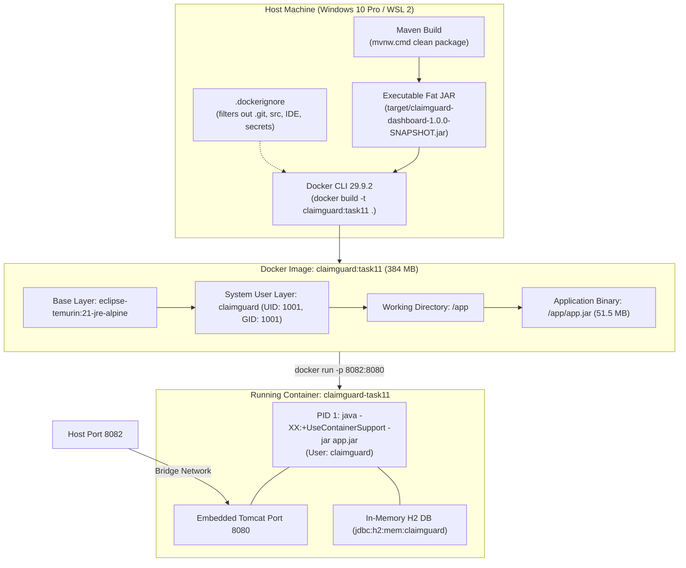

# Task 11 — Docker Image and Container Lifecycle

**Project:** ClaimGuard — Claim Fraud Review Dashboard  
**Assignment Module:** Jenkins Deployment for a Claim Fraud Review Dashboard  
**Author:** Raj Yadav  
**Date:** 2026-10-22  
**Branch:** `main`  
**Host Environment:** Windows 10 Pro 22H2 (Build 19045), WSL 2 Linux Engine  
**Docker Engine Version:** Docker 29.9.2 (Desktop 4.96.2, Build a82e528)  
**Image Name & Tag:** `claimguard:task11`  
**Base Image:** `eclipse-temurin:21-jre-alpine`  
**Host Port Mapping:** `8082:8080` (Spring Boot internal port `8080`)  

---

## 1. Executive Summary & Objectives

Task 11 marks the transition from continuous testing inside Jenkins into standardized **containerized packaging and container lifecycle operations**. Containerization ensures runtime immutability, isolates host system dependencies, guarantees that runtime behavior in testing matches deployment environments, and provides a uniform interface for orchestration and pipeline automation (Task 12).

### 1.1 Core Objectives for Task 11
1. **Production-Conscious Image Architecture:** Create a hardened `Dockerfile` utilizing an official, lightweight Java 21 runtime base image (`eclipse-temurin:21-jre-alpine`), avoiding heavyweight build tools inside the runtime container.
2. **Principle of Least Privilege (Non-Root Execution):** Define a dedicated system group and unprivileged user (`claimguard:claimguard`, UID/GID 1001) to prevent potential container breakout vulnerabilities.
3. **Optimized Build Context & Security Hygiene:** Implement a comprehensive `.dockerignore` file that prevents leakages of source files, `.git` history, local IDE configs, secrets, temporary logs, and build debris while ensuring the required Spring Boot fat JAR (`target/claimguard-dashboard-1.0.0-SNAPSHOT.jar`) is accessible.
4. **Container-Aware JVM Configuration & Exec-Form Entrypoint:** Configure pure JSON-form `ENTRYPOINT` (`["java", ...]`) with `-XX:+UseContainerSupport` and `-XX:MaxRAMPercentage=75.0` so the JVM respects Linux cgroup boundaries and receives OS process signals (SIGTERM/SIGINT) directly as PID 1.
5. **Non-Disruptive Host Port Strategy:** Bind the container to host port **8082** (`-p 8082:8080`), strictly preventing collisions with the live application on port 8080 and the Jenkins master server on port 8081.
6. **End-to-End Verification & Lifecycle Operations:** Systematically verify container startup, logs, HTTP health status, static UI assets, and REST APIs, followed by testing the complete container lifecycle (`run`, `inspect`, `stop`, verify stopped, `start`, verify operational recovery).

---

## 2. Architecture & Design Decisions

### 2.1 Pre-Built JAR vs. In-Docker Multi-Stage Build

| Consideration | Pre-Built JAR Workflow (Selected) | Multi-Stage Build Inside Docker | Rationale for Selection |
|:---|:---|:---|:---|
| **Build Tooling** | Handled by local/Jenkins Maven Wrapper (`mvnw`) | Requires Maven and full JDK 21 inside build layer | Preserves existing Jenkins pipeline where Unit/Integration tests and Selenium E2E tests execute against the JAR in earlier stages. |
| **CI Cache & Efficiency** | Reuses host/Jenkins `.m2` repository | Redownloads or requires volume mounts for dependencies | Significantly faster container build time (seconds vs. minutes) and zero network overhead during image creation. |
| **Runtime Footprint** | Small runtime image containing only JRE 21 and the fat JAR (~384 MB) | Final stage identical, but requires build stage | Clean boundary: CI builds & tests the artifact; Docker packages the verified artifact. |
| **Security Surface** | Minimal: No compilers (`javac`), Maven plugins, or package managers | Build stage may retain intermediate cached dependencies | Reduces attack surface in the runtime layer. |

### 2.2 Container Architecture Diagram



---

## 3. Implementation Details

### 3.1 Hardened `.dockerignore`

The `.dockerignore` ensures that only the minimum necessary artifact enters the Docker build context. This prevents credential exposure, avoids bloat, and accelerates context transfer to the Docker daemon.

```dockerignore
# ==============================================================================
# .dockerignore for ClaimGuard Fraud Review Dashboard
# Excludes source code, docs, IDE artifacts, and secrets while preserving
# the pre-built Spring Boot executable JAR in target/.
# ==============================================================================

# Version Control
.git/
.gitignore

# IDE & Editor Files
.idea/
.vscode/
*.iml
*.iws
*.ipr
.settings/
.classpath
.project

# Maven Source and Build Cache (pre-built JAR workflow)
.mvn/
src/
pom.xml
mvnw
mvnw.cmd

# Build Artifacts: Ignore all target contents EXCEPT the production JAR
target/*
!target/claimguard-dashboard-1.0.0-SNAPSHOT.jar

# Logs, PIDs, and Temp Files
*.log
logs/
*.pid
*.tmp

# Secrets, Environment Files, and Keys
*.env
*.env.*
*.secret
*.pem
*.key
*.pfx
*.jks

# Documentation, Scripts, and CI Pipeline (Not needed inside container)
docs/
scripts/
Jenkinsfile
README.md

# OS Artifacts
.DS_Store
Thumbs.db
desktop.ini
```

### 3.2 Production-Conscious `Dockerfile`

```dockerfile
# ==============================================================================
# Dockerfile for ClaimGuard Fraud Review Dashboard
# Task 11: Production-Conscious Runtime Image
# Runs the pre-built Spring Boot executable JAR on Eclipse Temurin JRE 21 (Alpine)
# ==============================================================================

FROM eclipse-temurin:21-jre-alpine

LABEL maintainer="ClaimGuard DevOps Team" \
      application="claimguard-dashboard" \
      version="1.0.0-SNAPSHOT" \
      task="Task-11-Docker-Lifecycle"

# Create application directory
WORKDIR /app

# Create a non-root group and user for secure, unprivileged execution
RUN addgroup -S -g 1001 claimguard && \
    adduser -S -u 1001 -G claimguard claimguard && \
    chown -R claimguard:claimguard /app

# Copy the pre-built production JAR with appropriate ownership
COPY --chown=claimguard:claimguard target/claimguard-dashboard-1.0.0-SNAPSHOT.jar app.jar

# Run as non-root user
USER claimguard:claimguard

# Container listens on standard Spring Boot port
EXPOSE 8080

# Production JVM flags with container cgroup awareness and pure JSON-form ENTRYPOINT
ENTRYPOINT ["java", "-XX:+UseContainerSupport", "-XX:MaxRAMPercentage=75.0", "-Djava.security.egd=file:/dev/./urandom", "-jar", "app.jar"]
```

#### Key Technical Elements:
1. **Base Image:** `eclipse-temurin:21-jre-alpine` provides a minimal, security-patched Alpine Linux 3.21 environment with OpenJDK JRE 21.0.12.1.
2. **Security Isolation:** `addgroup -S -g 1001 claimguard` and `adduser -S -u 1001 -G claimguard claimguard` create a dedicated system account. `USER claimguard:claimguard` guarantees that all processes run without root privileges.
3. **JSON-Form `ENTRYPOINT`:** Pure exec format (`["java", ...]`) executes Java as PID 1 directly without an intermediary `/bin/sh`. This ensures POSIX signals like `SIGTERM` (sent by `docker stop`) are received immediately by the JVM, allowing Spring Boot to cleanly invoke shutdown hooks, flush database transactions, and terminate gracefully within Docker's 10-second grace period.
4. **Container Support JVM Flags:**
   - `-XX:+UseContainerSupport`: Enforces container CPU and memory quota detection.
   - `-XX:MaxRAMPercentage=75.0`: Dynamically calculates maximum heap size based on container cgroup memory limits (leaving 25% for Metaspace, thread stacks, and OS buffers).
   - `-Djava.security.egd=file:/dev/./urandom`: Prevents cryptographic entropy exhaustion delays during SSL or session token generation.

---

## 4. Execution Commands & Build Verification

### 4.1 Step 1: Pre-Flight Application Packaging

The Spring Boot executable JAR was compiled, tested (11 unit/MockMvc tests passing), and packaged locally:

```powershell
.\mvnw.cmd clean package
```

**Build Output:**
- **Status:** `BUILD SUCCESS`
- **Total Time:** 21.326 s
- **Artifact Path:** `target/claimguard-dashboard-1.0.0-SNAPSHOT.jar`
- **Artifact Size:** 51,549,626 bytes (~51.5 MB)

### 4.2 Step 2: Docker Image Build

The Docker image was built using the Docker BuildKit engine on WSL 2:

```powershell
$dockerBin = "$env:LOCALAPPDATA\Programs\DockerDesktop\resources\bin"
$env:Path = "$dockerBin;$env:Path"
docker build -t claimguard:task11 .
```

**Build Execution Log Summary:**
```text
#0 building with "desktop-linux" instance using docker driver
#1 [internal] load build definition from Dockerfile
#1 transferring dockerfile: 1.32kB done
#2 [internal] load metadata for docker.io/library/eclipse-temurin:21-jre-alpine
#3 [internal] load .dockerignore
#4 [internal] load build context: transferring context: 51.56MB 6.9s done
#5 [1/4] FROM docker.io/library/eclipse-temurin:21-jre-alpine
#6 [2/4] WORKDIR /app
#7 [3/4] RUN addgroup -S -g 1001 claimguard && adduser -S -u 1001 -G claimguard claimguard && chown -R claimguard:claimguard /app
#8 [4/4] COPY --chown=claimguard:claimguard target/claimguard-dashboard-1.0.0-SNAPSHOT.jar app.jar
#9 exporting to image: exporting layers, config sha256:7cb523cb..., manifest sha256:b0cafbe4...
#9 naming to docker.io/library/claimguard:task11 done
```

### 4.3 Step 3: Image Inspection & Layer Verification

```powershell
docker images claimguard:task11 --digests
```

**Output:**
```text
REPOSITORY   TAG       DIGEST                                                                    IMAGE ID       CREATED         SIZE
claimguard   task11    sha256:cd6bcc900cef16adc8759813a4d3e03b94d3bbb275847edb6d8f4c0d0933de5c   cd6bcc900cef   2 minutes ago   384MB
```

`docker inspect claimguard:task11` confirmed:
- **Image ID:** `sha256:cd6bcc900cef16adc8759813a4d3e03b94d3bbb275847edb6d8f4c0d0933de5c`
- **Architecture/OS:** `amd64` / `linux`
- **Configured User:** `claimguard:claimguard`
- **Exposed Ports:** `8080/tcp`
- **Entrypoint:** `["java", "-XX:+UseContainerSupport", "-XX:MaxRAMPercentage=75.0", "-Djava.security.egd=file:/dev/./urandom", "-jar", "app.jar"]`

---

## 5. Container Lifecycle Operations & Results

### 5.1 Host Port Check & Container Run

Host port availability was verified before starting the container:
- Port `8080`: Idle
- Port `8081`: Reserved by Jenkins Master (PID 9956)
- Port `8082`: Verified free (`netstat -ano | findstr ":8082"` returned empty)

```powershell
docker run -d --name claimguard-task11 -p 8082:8080 claimguard:task11
```

**Result:**
- **Container ID:** `d39013d2a0533c6acb5a8a97296a9bf646ab6dd80a5a8fc028e763d8aa74ce69`
- **Container Name:** `claimguard-task11`
- **Port Mapping:** `0.0.0.0:8082->8080/tcp`, `[::]:8082->8080/tcp`

### 5.2 Container Status and Startup Logs

```powershell
docker ps --filter "name=claimguard-task11"
docker logs claimguard-task11
```

**Verified Log Evidence:**
```text
  .   ____          _            __ _ _
 /\\ / ___'_ __ _ _(_)_ __  __ _ \ \ \ \
( ( )\___ | '_ | '_| | '_ \/ _` | \ \ \ \
 \\/  ___)| |_)| | | | | || (_| |  ) ) ) )
  '  |____| .__|_| |_|_| |_\__, | / / / /
 =========|_|==============|___/=/_/_/_/

 :: Spring Boot ::                (v3.3.4)

2026-10-22T12:49:26.394Z  INFO 1 --- [claimguard-dashboard] [           main] c.c.dashboard.ClaimGuardApplication      : Starting ClaimGuardApplication v1.0.0-SNAPSHOT using Java 21.0.12.1 with PID 1 (/app/app.jar started by claimguard in /app)
2026-10-22T12:49:26.401Z  INFO 1 --- [claimguard-dashboard] [           main] c.c.dashboard.ClaimGuardApplication      : No active profile set, falling back to 1 default profile: "default"
2026-10-22T12:49:28.051Z  INFO 1 --- [claimguard-dashboard] [           main] .s.d.r.c.RepositoryConfigurationDelegate : Finished Spring Data repository scanning in 129 ms. Found 4 JPA repository interfaces.
2026-10-22T12:49:29.044Z  INFO 1 --- [claimguard-dashboard] [           main] o.s.b.w.embedded.tomcat.TomcatWebServer  : Tomcat initialized with port 8080 (http)
2026-10-22T12:49:29.461Z  INFO 1 --- [claimguard-dashboard] [           main] com.zaxxer.hikari.HikariDataSource       : HikariPool-1 - Start completed.
2026-10-22T12:49:31.604Z  INFO 1 --- [claimguard-dashboard] [           main] j.LocalContainerEntityManagerFactoryBean : Initialized JPA EntityManagerFactory for persistence unit 'default'
2026-10-22T12:49:32.971Z  INFO 1 --- [claimguard-dashboard] [           main] o.s.b.a.w.s.WelcomePageHandlerMapping    : Adding welcome page: class path resource [static/index.html]
2026-10-22T12:49:33.736Z  INFO 1 --- [claimguard-dashboard] [           main] o.s.b.w.embedded.tomcat.TomcatWebServer  : Tomcat started on port 8080 (http) with context path '/'
2026-10-22T12:49:33.748Z  INFO 1 --- [claimguard-dashboard] [           main] c.c.dashboard.ClaimGuardApplication      : Started ClaimGuardApplication in 8.178 seconds (process running for 8.89)
```

**Key Log Observations:**
- PID is `1` (`using Java 21.0.12.1 with PID 1`).
- Started by non-root user `claimguard` in `/app`.
- In-memory H2 database seeded and ready.
- Embedded Tomcat listening on container port `8080`.

### 5.3 Live HTTP Endpoint Verification

All three required endpoints (plus the REST API) were queried over host port `8082`:

```powershell
# 1. Health Probe Verification
$respHealth = Invoke-WebRequest -Uri "http://localhost:8082/api/health" -UseBasicParsing
# 2. Root Index Dashboard Verification
$respRoot = Invoke-WebRequest -Uri "http://localhost:8082/" -UseBasicParsing
# 3. Claims Directory View Verification
$respClaims = Invoke-WebRequest -Uri "http://localhost:8082/claims.html" -UseBasicParsing
# 4. Claims REST API Verification
$respApi = Invoke-WebRequest -Uri "http://localhost:8082/api/claims" -UseBasicParsing
```

#### Verification Summary Table:

| Target Endpoint | HTTP Status | Content-Type | Payload / Verification Content | Result |
|:---|:---:|:---|:---|:---:|
| `http://localhost:8082/api/health` | **200 OK** | `application/json` | `{"database":"H2 In-Memory (Operational)","application":"ClaimGuard Fraud Review Dashboard","version":"1.0.0-SNAPSHOT","status":"UP","timestamp":"2026-10-22T12:49:57.778704616"}` | **PASS** |
| `http://localhost:8082/` | **200 OK** | `text/html;charset=UTF-8` | 32,429 bytes; `<!DOCTYPE html> ... <title>ClaimGuard - Operations Executive Dashboard</title>` | **PASS** |
| `http://localhost:8082/claims.html` | **200 OK** | `text/html` | 27,113 bytes; `<!DOCTYPE html> ... <title>ClaimGuard — All Claims Directory</title>` | **PASS** |
| `http://localhost:8082/api/claims` | **200 OK** | `application/json` | JSON Page object with `totalElements: 5, totalPages: 1`, returning all 5 pre-seeded test claims | **PASS** |

### 5.4 Container Lifecycle Test (Stop, Inspect, Restart)

The complete lifecycle of the container was exercised:

```powershell
# 1. Inspect running container state
docker inspect --format 'State: {{.State.Status}} | Running: {{.State.Running}} | Pid: {{.State.Pid}}' claimguard-task11
# Result: State: running | Running: true | Pid: 502

# 2. Stop container
docker stop claimguard-task11
# Result: Output: claimguard-task11

# 3. Confirm container is stopped
docker ps -a --filter "name=claimguard-task11"
docker inspect --format 'State: {{.State.Status}} | Running: {{.State.Running}} | ExitCode: {{.State.ExitCode}}' claimguard-task11
# Result: State: exited | Running: false | ExitCode: 143 (SIGTERM graceful exit)

# 4. Confirm port 8082 is unreachable when stopped
try { Invoke-WebRequest -Uri "http://localhost:8082/api/health" -UseBasicParsing -TimeoutSec 3 }
catch { Write-Output "Connection closed / port unreachable as expected" }
# Result: The underlying connection was closed (Verified stopped)

# 5. Start container again
docker start claimguard-task11
# Result: Output: claimguard-task11

# 6. Confirm container running after restart
docker ps --filter "name=claimguard-task11"
docker inspect --format 'State: {{.State.Status}} | Running: {{.State.Running}} | Pid: {{.State.Pid}}' claimguard-task11
# Result: State: running | Running: true | Pid: 642

# 7. Verify health endpoint responds 200 OK after restart
$respRestart = Invoke-WebRequest -Uri "http://localhost:8082/api/health" -UseBasicParsing
# Result: HTTP 200 OK | {"database":"H2 In-Memory (Operational)","application":"ClaimGuard Fraud Review Dashboard","version":"1.0.0-SNAPSHOT","status":"UP","timestamp":"2026-10-22T12:51:56.844548448"}
```

**Lifecycle Verification Observations:**
1. **Clean Exit Code 143:** Upon receiving `docker stop`, Java exited with status code `143` (`128 + 15 = SIGTERM`), demonstrating that SIGTERM reached PID 1 and Spring Boot executed an orderly shutdown rather than being forcibly killed with SIGKILL (`137`).
2. **Rapid Recovery:** Upon `docker start`, the container re-initialized Spring Boot and H2 in 6.38 seconds, immediately regaining operational health on port 8082.

---

## 6. Screenshots & Evidence Guide for Submissions

When capturing visual proof for the assignment report or presentation, capture the following 6 artifacts:

1. **Local Maven Build:** Terminal displaying `.\mvnw.cmd clean package` producing `BUILD SUCCESS` and the JAR in `target/`.
2. **Docker Build Output:** Terminal showing `docker build -t claimguard:task11 .` with BuildKit layers, context transfer (~51.5 MB), and image tagging.
3. **Docker Image Inspection:** Terminal showing `docker images claimguard:task11` and `docker inspect` highlighting the non-root user `claimguard:claimguard` and JSON entrypoint.
4. **Container Launch & Logs:** Terminal displaying `docker run -d --name claimguard-task11 -p 8082:8080 claimguard:task11` followed by `docker logs claimguard-task11` showing the Spring Boot banner and `PID 1 (/app/app.jar started by claimguard in /app)`.
5. **Browser Verification on Port 8082:** Browser windows showing:
   - `http://localhost:8082/` (Operations Executive Dashboard)
   - `http://localhost:8082/claims.html` (Claims Directory Table)
   - `http://localhost:8082/api/health` (JSON `{"status":"UP",...}`)
6. **Container Lifecycle Proof:** Terminal showing `docker stop claimguard-task11`, `docker ps -a` showing `Exited (143)`, followed by `docker start claimguard-task11` and a successful `curl` or `Invoke-WebRequest` to `/api/health`.

---

## 7. Operational Boundaries & Limitations

1. **H2 In-Memory Reset on Container Restart:**
   - The embedded H2 database (`jdbc:h2:mem:claimguard`) resides in container RAM.
   - Stopping and restarting the container re-seeds the database with the initial 5 synthetic baseline claims. Any newly submitted claims created during that container session are reset. Persistent volumes or external PostgreSQL/MySQL databases will be addressed in future stages.
2. **Host Port Dedication:**
   - Container port `8080` is mapped to host port `8082` to avoid conflicts with developer workstations (port 8080) and Jenkins (port 8081).
3. **Docker Desktop on Windows Dependency:**
   - Container execution requires the Docker Desktop Linux daemon via WSL 2. When migrating to a headless Linux CI agent (Task 12), the Docker CLI commands run natively against the host Docker daemon.

---

## 8. Comprehensive Viva Defense Questions & Answers

### Q1: Why should applications in Docker containers run as a non-root user?
**Answer:** By default, Docker containers run processes as `root` (UID 0), which matches the root user on the host Linux kernel (unless user namespaces are remapped). If an attacker finds a remote code execution (RCE) flaw or container breakout exploit (e.g., through a vulnerable library), they would possess root privileges on the host kernel or mounted volumes. By creating and switching to an unprivileged system user (`claimguard:claimguard`, UID 1001), the process operates under the Principle of Least Privilege: even in the event of an application compromise, file write access, kernel capability usage, and host compromise are strictly restricted.

### Q2: What is the significance of using the JSON exec form for `ENTRYPOINT` (`["java", ... ]`) vs. shell form (`ENTRYPOINT java ...`)?
**Answer:** 
- In **shell form** (`ENTRYPOINT java -jar app.jar`), Docker invokes `/bin/sh -c "java -jar app.jar"`. The shell becomes PID 1, and the Java process is a child PID. Most shells do not forward POSIX signals like `SIGTERM` to child processes. When `docker stop` sends `SIGTERM`, Java never receives it; the container hangs until Docker’s 10-second timeout expires, at which point Docker forcibly issues `SIGKILL` (exit code 137), risking corrupted state and abrupt shutdown.
- In **JSON exec form** (`ENTRYPOINT ["java", ...]`), no shell is spawned; `java` runs directly as PID 1. When `docker stop` is invoked, `SIGTERM` is delivered directly to the Java runtime. Spring Boot catches this signal, invokes its shutdown hooks, gracefully releases resources, closes HikariCP connection pools, and exits cleanly with code `143` (`128 + 15`).

### Q3: Why did we package an existing JAR rather than performing a multi-stage Maven build inside Docker?
**Answer:** In our Jenkins CI/CD pipeline, the build, unit/integration testing (11 tests), and Selenium E2E testing (6 browser tests) are executed as prior, gated pipeline stages using the Maven Wrapper. Re-compiling inside Docker would duplicate compilation, duplicate unit tests, redownload or re-cache Maven dependencies, and substantially increase build duration. By packaging the already-tested, verified fat JAR artifact, we maintain a clean separation of concerns: Maven builds and validates the artifact; Docker packages and distributes the verified artifact in seconds.

### Q4: Why is `.dockerignore` critical when building from an existing project workspace?
**Answer:** When `docker build` runs, the Docker CLI first archives the entire current directory and transmits it as the "build context" over the Docker daemon socket. Without `.dockerignore`:
1. The `.git` directory, source files, IDE directories (`.idea`, `.vscode`), test logs, and temporary files would all be transmitted, turning a 50 MB transfer into hundreds of megabytes.
2. Any secrets, `.env` files, or local keys in the workspace could accidentally be copied into the image filesystem, leaking sensitive information.
3. Build caching is invalidated whenever any irrelevant file (such as a local log file or README) is modified.
Our `.dockerignore` excluded all source code and temporary files while whitelisting only `target/claimguard-dashboard-1.0.0-SNAPSHOT.jar`, keeping the transfer context to exactly 51.56 MB.

### Q5: What do `-XX:+UseContainerSupport` and `-XX:MaxRAMPercentage=75.0` do?
**Answer:** In containerized environments, the JVM needs to know the memory limits enforced by Docker cgroups (e.g. `--memory 512m`) rather than the host's total physical RAM (which might be 16 GB or 32 GB).
- `-XX:+UseContainerSupport` (enabled by default in Java 21) instructs the JVM to read cgroup limits for CPU cores and RAM.
- `-XX:MaxRAMPercentage=75.0` configures the maximum JVM heap size to 75% of the container's allocated memory limit, leaving the remaining 25% for off-heap allocations, Metaspace, thread stacks, garbage collector structures, and OS overhead. This prevents the Linux Out-Of-Memory (OOM) killer from terminating the container.

### Q6: What does exit code 143 mean when the container is stopped?
**Answer:** In Unix-like operating systems, an exit code greater than 128 indicates that the process was terminated by a signal. The signal number equals the exit code minus 128:
$$\text{Signal} = 143 - 128 = 15$$
Signal 15 is `SIGTERM` (the standard graceful termination signal sent by `docker stop`). An exit code of 143 confirms that Java received `SIGTERM`, executed its graceful shutdown hooks, and exited cleanly. In contrast, exit code 137 ($128 + 9 = \text{SIGKILL}$) would indicate that the application failed to terminate in time and had to be forcefully killed by the kernel.

### Q7: How does Docker port mapping (`-p 8082:8080`) work under the hood?
**Answer:** Docker assigns each container its own isolated network namespace with a private IP address on a bridge network (e.g. `172.17.0.x`). When `-p 8082:8080` is specified, the Docker daemon configures Linux `iptables` / NAT packet filtering rules on the host (or via Docker Desktop's VPNKit proxy on Windows/WSL2). Incoming TCP packets arriving at host port `8082` are network address translated (DNAT) and forwarded to port `8080` inside the container's virtual ethernet interface.

### Q8: How does Task 11 prepare the project for Task 12 (Automated Jenkins + Docker Pipeline)?
**Answer:** In Task 11, we established a deterministic, repeatable Dockerfile, build command, and container lifecycle protocol. In Task 12, this process is automated inside the `Jenkinsfile` Declarative Pipeline by adding a `Build Docker Image` stage (running `docker build -t claimguard:${BUILD_NUMBER}`) and a `Deploy Staging Container` stage (stopping any stale container, running the new image on a designated port, and probing `/api/health` before passing the build).

---

*ClaimGuard — Claim Fraud Review Dashboard | College DevOps Assignment | Raj Yadav | 2026*
