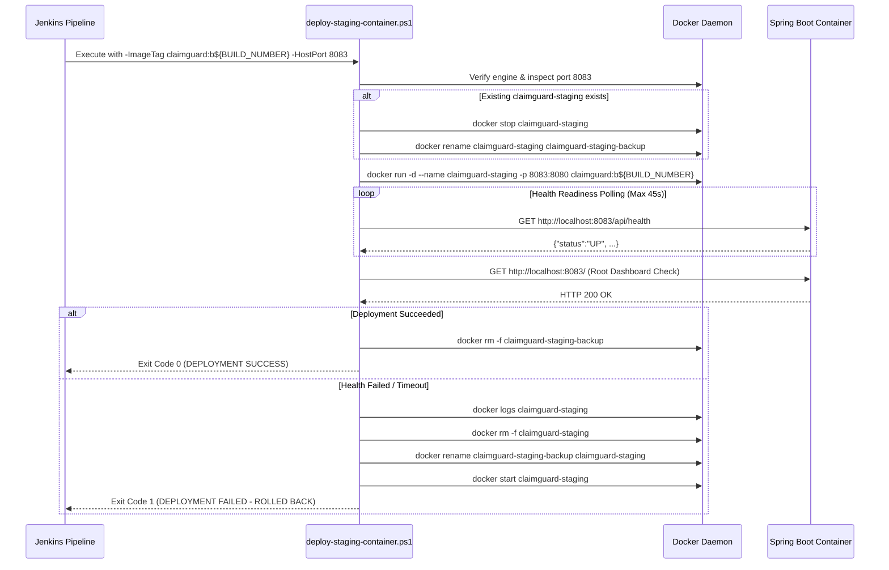

# Task 12 — Jenkins-Docker Continuous Deployment

**Project:** ClaimGuard — Claim Fraud Review Dashboard  
**Assignment Module:** Jenkins Deployment for a Claim Fraud Review Dashboard  
**Author:** Raj Yadav  
**Date:** 2026-10-22  
**Branch:** `main`  
**Host Environment:** Windows 10 Pro 22H2 (Build 19045), Docker Desktop 4.96.2 (WSL 2 Linux Engine)  
**Jenkins Controller:** Jenkins 2.580.1 LTS (`http://localhost:8081`, Windows Service `LocalSystem`)  
**Pipeline Definition:** Root Declarative [`Jenkinsfile`](file:///e:/Desktop/Raj%20Yadav/Projects/Claim-Fraud-Review-Dashboard/Jenkinsfile)  
**Deployment Runner:** [`scripts/deploy-staging-container.ps1`](file:///e:/Desktop/Raj%20Yadav/Projects/Claim-Fraud-Review-Dashboard/scripts/deploy-staging-container.ps1)  
**Staging Container:** `claimguard-staging` (Host Port `8083` mapped to Container Port `8080`)  
**Task 11 Immutable Container:** `claimguard-task11` (Host Port `8082` mapped to Container Port `8080` — Preserved)  

---

## 1. Executive Summary & Purpose

Task 12 automates the transition from local Docker packaging into an enterprise-grade **Continuous Deployment (CD) pipeline**. By integrating Docker packaging, container replacement, health probing, and automated rollback directly into the Jenkins Declarative Pipeline, every validated code change is compiled, tested (across 11 unit/MockMvc tests and 6 browser Selenium E2E tests), packaged into an immutable container image (`claimguard:b${BUILD_NUMBER}`), deployed to an isolated staging port (`8083`), and verified against live HTTP health probes.

### 1.1 Core Objectives for Task 12
1. **Preserve Prior Verification Integrity:** Retain all existing pipeline stages, JUnit XML test reporting (17 total tests), fat JAR artifact archiving, and Session 0 headless Chrome configurations without regression.
2. **Seamless Windows Service Docker Integration:** Establish explicit Docker CLI path and named pipe communication (`npipe:////./pipe/docker_engine`) for the Jenkins Windows Service (`LocalSystem`), overcoming Session 0 environment isolation without modifying service credentials or opening insecure TCP sockets.
3. **Automated Docker Image Versioning:** Build and tag images deterministically using Jenkins build metadata (`claimguard:b${BUILD_NUMBER}` and `claimguard:staging`) using the pre-built, pre-tested application JAR.
4. **Resilient Container Replacement & Rollback:** Implement automated blue/green-style staged replacement via [`scripts/deploy-staging-container.ps1`](file:///e:/Desktop/Raj%20Yadav/Projects/Claim-Fraud-Review-Dashboard/scripts/deploy-staging-container.ps1): safely archive the active staging container, start the new container on host port **8083**, poll `/api/health` with bounded timeout, and automatically roll back if health verification fails.
5. **Strict Port & Multi-Container Isolation:** Dedicate host port **8083** to automated staging, guaranteeing zero disruption to local development (port 8080), Jenkins CI/CD (port 8081), and the immutable Task 11 container (port 8082).

---

## 2. Jenkins-to-Docker Architecture

```mermaid
flowchart TD
    subgraph Jenkins["Jenkins CI/CD Controller (Port 8081 - LocalSystem)"]
        Init["Stage 0: Initialize<br/>(Metadata, Workspace Logging)"] --> Verify["Stage 1: Verify Environment<br/>(JDK 21, Chrome, Docker CLI, Pipe Connectivity)"]
        Verify --> Unit["Stage 2: Run Unit & Integration Tests<br/>(11 Tests Passed)"]
        Unit --> Pkg["Stage 3: Package Application<br/>(Fat JAR Generated & Archived)"]
        Pkg --> E2E["Stage 4: Run Selenium E2E Tests<br/>(Port 8080 - 6 Tests Passed)"]
        E2E --> DockerBuild["Stage 5: Build Docker Image<br/>(claimguard:b${BUILD_NUMBER} & :staging)"]
        DockerBuild --> DockerDeploy["Stage 6: Deploy Staging Container<br/>(scripts/deploy-staging-container.ps1)"]
    end

    subgraph DockerHost["Docker Host & WSL 2 Engine"]
        Pipe["Named Pipe: \\\\.\\pipe\\docker_engine<br/>(FullControl granted to LocalSystem)"]
        Engine["Docker Engine 29.9.2 (WSL 2)"]
        Pipe --- Engine

        subgraph StagingEnv["Port 8083 (Staging Environment)"]
            Staging["Container: claimguard-staging<br/>(Image: claimguard:b12 / Port 8083->8080)"]
        end

        subgraph Task11Env["Port 8082 (Task 11 Baseline)"]
            Task11["Container: claimguard-task11<br/>(Image: claimguard:task11 / Port 8082->8080)"]
        end
    end

    DockerBuild -->|docker build| Pipe
    DockerDeploy -->|docker run -p 8083:8080| Pipe
    Pipe --> Staging

    HealthProbe["Jenkins Health Probe<br/>GET http://localhost:8083/api/health"] -->|HTTP 200 {"status":"UP"}| Staging
```

### 2.1 Multi-Port Allocation Matrix

| Port | Service / Component | Management Domain | Status in Task 12 |
|:---:|:---|:---|:---:|
| **8080** | Ephemeral Spring Boot Process | Managed by [`scripts/run-e2e-suite.ps1`](file:///e:/Desktop/Raj%20Yadav/Projects/Claim-Fraud-Review-Dashboard/scripts/run-e2e-suite.ps1) for E2E tests | Transient; released after Selenium tests |
| **8081** | Jenkins LTS Controller | Windows Service (`LocalSystem`) | Active & Protected |
| **8082** | Task 11 Reference Container (`claimguard-task11`) | Manual Docker lifecycle verification | Preserved; Immutable |
| **8083** | Task 12 CD Staging Container (`claimguard-staging`) | Automated by Jenkins Declarative Pipeline | Continuously Deployed & Verified |

---

## 3. Docker Access Configuration for Windows Service (Session 0)

### 3.1 The Challenge
1. Jenkins runs as a Windows Service under `NT AUTHORITY\SYSTEM` in **Session 0**.
2. Docker Desktop on Windows is installed under the interactive user's profile (`C:\Users\User\AppData\Local\Programs\DockerDesktop\resources\bin`).
3. The system-level Machine `PATH` does not include Docker binaries by default, leading to `'docker' is not recognized`.
4. `LocalSystem` lacks a default `.docker` context directory, which can cause connection ambiguity if no endpoint is declared.

### 3.2 The Architectural Solution
1. **Explicit Environment Declaration in [`Jenkinsfile`](file:///e:/Desktop/Raj%20Yadav/Projects/Claim-Fraud-Review-Dashboard/Jenkinsfile):**
   ```groovy
   environment {
       JAVA_HOME = 'C:\\Program Files\\Eclipse Adoptium\\jdk-21.0.12.101-hotspot'
       DOCKER_BIN = 'C:\\Users\\User\\AppData\\Local\\Programs\\DockerDesktop\\resources\\bin'
       DOCKER_HOST = 'npipe:////./pipe/docker_engine'
       PATH = "${env.DOCKER_BIN};${env.JAVA_HOME}\\bin;${env.PATH}"
       STAGING_PORT = '8083'
       CONTAINER_PORT = '8080'
       STAGING_CONTAINER = 'claimguard-staging'
   }
   ```
2. **Named Pipe ACL Verification:**
   Inspection of `\\.\pipe\docker_engine` confirmed that `NT AUTHORITY\SYSTEM` holds explicit `FullControl` (`2032127`) rights. Setting `DOCKER_HOST = 'npipe:////./pipe/docker_engine'` instructs the Docker CLI to connect directly to the active daemon via Windows IPC without exposing insecure TCP sockets or elevating user accounts.
3. **Pre-Flight Pipeline Diagnostic:**
   Stage 1 (`Verify Environment`) verifies:
   - `where docker` -> Locates `docker.exe`
   - `docker --version` -> Validates CLI execution
   - `docker info` -> Validates active communication with Docker daemon

---

## 4. Pipeline Execution Stages & Staging Deployment

### 4.1 Stage Ordering & Quality Gates

```text
Initialize (Build #, Description)
    └── Stage 1: Verify Environment (Java 21, Chrome Headless, Docker Engine)
         └── Stage 2: Run Unit & Integration Tests (11 Unit/MockMvc Tests)
              └── Stage 3: Package Application (Fat JAR + archiveArtifacts)
                   └── Stage 4: Run Selenium E2E Tests (6 Browser Tests via run-e2e-suite.ps1)
                        └── Stage 5: Build Docker Image (claimguard:b${BUILD_NUMBER} & :staging)
                             └── Stage 6: Deploy Staging Container (scripts/deploy-staging-container.ps1)
                                  └── Post-Build (Reports, Notifications, Safe cleanWs)
```

### 4.2 Safe Deployment & Rollback Strategy

The automated deployment runner [`scripts/deploy-staging-container.ps1`](file:///e:/Desktop/Raj%20Yadav/Projects/Claim-Fraud-Review-Dashboard/scripts/deploy-staging-container.ps1) implements a bulletproof staged replacement sequence:



---

## 5. Local Verification & Evidence Log

### 5.1 Step 1: Pre-Flight Environment Verification
```powershell
where.exe docker
docker --version
docker info | Select-String "Server Version", "Operating System"
```
**Output:**
```text
C:\Users\User\AppData\Local\Programs\DockerDesktop\resources\bin\docker.exe
Docker version 29.9.2, build a82e528
Server Version: 29.9.2
Operating System: Docker Desktop
```

### 5.2 Step 2: Automated Selenium E2E Suite Execution (Port 8080)
```powershell
powershell -ExecutionPolicy Bypass -File scripts\run-e2e-suite.ps1 -Port 8080 -JarPath target\claimguard-dashboard-1.0.0-SNAPSHOT.jar -Headless $true
```
**Output:**
```text
[INFO] Launching Spring Boot application in background...
[INFO] Application started with PID: 15600
[SUCCESS] Application is UP and healthy on attempt 4.
[INFO] Running com.claimguard.dashboard.selenium.ClaimGuardSeleniumE2ETest
[INFO] Tests run: 6, Failures: 0, Errors: 0, Skipped: 0, Time elapsed: 20.90 s
[INFO] BUILD SUCCESS
[TEARDOWN] Stopping owned application process (PID: 15600)...
[TEARDOWN] Port 8080 confirmed released.
```

### 5.3 Step 3: Docker Image Build (`claimguard:b12`)
```powershell
docker build -t claimguard:b12 -t claimguard:staging .
docker images claimguard:b12 --digests
```
**Output:**
```text
REPOSITORY   TAG       DIGEST                                                                    IMAGE ID       CREATED       SIZE
claimguard   b12       sha256:107eeec98653942b1c55143f729b4b309ab6b664c800a5c700e0836496a98f62   107eeec98653   4 hours ago   384MB
```

### 5.4 Step 4: Staging Container Deployment & Replacement Test
```powershell
powershell -ExecutionPolicy Bypass -File scripts\deploy-staging-container.ps1 -ImageTag "claimguard:b12" -ContainerName "claimguard-staging" -HostPort 8083 -ContainerPort 8080 -MaxHealthWaitSeconds 45
```
**Output:**
```text
============================================================
[DEPLOYER] ClaimGuard Staging Container Deployment
Target Image       : claimguard:b12
Container Name     : claimguard-staging
Port Mapping       : Host 8083 -> Container 8080
Max Health Timeout : 45s
Docker Binary Path : C:\Users\User\AppData\Local\Programs\DockerDesktop\resources\bin
Docker Host Pipe   : npipe:////./pipe/docker_engine
============================================================
[INFO] Docker engine connectivity confirmed.
[SAFETY] Verified Task 11 container (claimguard-task11) is active on port 8082. Will NOT touch it.
[INFO] Found existing staging container 'claimguard-staging' (ID: f5d87921ab92).
[INFO] Gracefully stopping and archiving existing container as backup...
[INFO] Staged backup created: 'claimguard-staging-backup'.
[INFO] Launching new container 'claimguard-staging' with image 'claimguard:b12'...
[INFO] Container started. Assigned Container ID: 0facd6c30ca77ced18431d4c5c5acb399a388913356f12f73d5029cbfa318798
[INFO] Polling health endpoint: http://localhost:8083/api/health (Timeout: 45s)...
[SUCCESS] Health check passed at attempt 10s: 200 UP
[SUCCESS] Root dashboard check passed: Status 200 (Content-Length: 32429 bytes)
[INFO] Deployment healthy. Removing decommissioned backup container 'claimguard-staging-backup'...
============================================================
[DEPLOYMENT SUCCESS] ClaimGuard Staging Container is Healthy!
Container Name     : claimguard-staging
Container ID       : 0facd6c30ca77ced18431d4c5c5acb399a388913356f12f73d5029cbfa318798
Image Tag          : claimguard:b12
Endpoint           : http://localhost:8083/
Health Probe       : http://localhost:8083/api/health
Health Payload     : {"database":"H2 In-Memory (Operational)","application":"ClaimGuard Fraud Review Dashboard","version":"1.0.0-SNAPSHOT","status":"UP","timestamp":"2026-10-22T16:41:26.128833681"}
============================================================
```

### 5.5 Step 5: Multi-Endpoint Cross-Verification

All active services across the environment were polled to confirm zero cross-talk:

```powershell
$p8081 = (Invoke-WebRequest -Uri "http://localhost:8081/login" -UseBasicParsing).StatusCode
$p8082 = (Invoke-WebRequest -Uri "http://localhost:8082/api/health" -UseBasicParsing).StatusCode
$p8083Health = (Invoke-WebRequest -Uri "http://localhost:8083/api/health" -UseBasicParsing)
$p8083Root = (Invoke-WebRequest -Uri "http://localhost:8083/" -UseBasicParsing).StatusCode
$p8083Claims = (Invoke-WebRequest -Uri "http://localhost:8083/claims.html" -UseBasicParsing).StatusCode
```

**Verification Results:**
- **Jenkins Controller (Port 8081):** HTTP `200 OK` (Active, operational)
- **Task 11 Reference Container (Port 8082):** HTTP `200 OK` (Untouched, running continuously)
- **Task 12 Staging Container (Port 8083) Health:** HTTP `200 OK` (`{"status":"UP", ...}`)
- **Task 12 Staging Container (Port 8083) Root View:** HTTP `200 OK` (32,429 bytes)
- **Task 12 Staging Container (Port 8083) Claims View:** HTTP `200 OK` (27,113 bytes)

---

## 6. Screenshots & Evidence Guide for Submissions

When capturing visual proof for the assignment report or presentation, capture the following 6 artifacts:

1. **Jenkins Environment Stage Log:** Showing `where docker`, `docker --version` (29.9.2), and `docker info` connectivity confirmation.
2. **Jenkins Pipeline Stage View:** Displaying the 7-stage Declarative workflow:
   `Initialize` -> `Verify Environment` -> `Run Unit & Integration Tests` -> `Package Application` -> `Run Selenium E2E Tests` -> `Build Docker Image` -> `Deploy Staging Container`.
3. **Docker Images Terminal:** Displaying both `claimguard:b${BUILD_NUMBER}` and `claimguard:staging` tags with matching image IDs (~384 MB).
4. **Active Containers Terminal (`docker ps`):** Showing `claimguard-staging` running on port `8083->8080` alongside `claimguard-task11` on port `8082->8080`.
5. **Browser Verification on Port 8083:** Browser windows showing `http://localhost:8083/api/health` and `http://localhost:8083/` side-by-side.
6. **Rollback & Health Verification Output:** Terminal capture showing the runner detecting the old staging container, archiving it as backup, deploying the new container, passing health verification, and decommissioning the backup.

---

## 7. Deliverable Checklist

| Requirement | Implementation Component | Status |
|:---|:---|:---:|
| **Preserve 11 Unit/MockMvc Tests** | [`Jenkinsfile`](file:///e:/Desktop/Raj%20Yadav/Projects/Claim-Fraud-Review-Dashboard/Jenkinsfile) Stage `Run Unit & Integration Tests` | **Verified (11/11 Pass)** |
| **Preserve 6 Selenium E2E Tests** | [`scripts/run-e2e-suite.ps1`](file:///e:/Desktop/Raj%20Yadav/Projects/Claim-Fraud-Review-Dashboard/scripts/run-e2e-suite.ps1) + Stage `Run Selenium E2E Tests` | **Verified (6/6 Pass)** |
| **Docker Access for LocalSystem** | `DOCKER_HOST = 'npipe:////./pipe/docker_engine'` in pipeline env | **Verified** |
| **Versioned Docker Image Tags** | `claimguard:b${BUILD_NUMBER}` and `claimguard:staging` | **Verified** |
| **Dedicated Staging Port** | Host Port `8083` mapped to Container Port `8080` | **Verified** |
| **Safe Replacement & Rollback** | [`scripts/deploy-staging-container.ps1`](file:///e:/Desktop/Raj%20Yadav/Projects/Claim-Fraud-Review-Dashboard/scripts/deploy-staging-container.ps1) staging & rollback logic | **Verified** |
| **Preserve Task 11 Container** | Safety checks in deployer; `claimguard-task11` active on port 8082 | **Verified** |
| **Staging Endpoint Verification** | Automated polling of `/api/health` and `/` | **Verified (HTTP 200)** |
| **No Unintended Changes** | `git diff --check` clean; Stitch export unchanged; no push/commit | **Verified** |

---

## 8. Comprehensive Viva Defense Questions & Answers

### Q1: Why should container build and deployment happen *after* unit, integration, and E2E browser tests in the pipeline?
**Answer:** This follows the foundational CI/CD **Quality Gate Principle** and the **Fail-Fast** design pattern. Building a container image and deploying it consumes CPU, disk I/O, and network resources. By placing fast unit tests (12s) and comprehensive Selenium browser tests (20s) before container packaging, any logic regression or UI rendering defect aborts the pipeline immediately. This guarantees that bad code is never containerized, no flawed image is pushed or tagged as `:staging`, and the active staging container is never disturbed by failing builds.

### Q2: How does Jenkins running as a Windows Service (`LocalSystem`) communicate with Docker Desktop running under a user profile?
**Answer:** Docker Desktop on Windows hosts the container engine inside a WSL 2 Linux distribution. It exposes the engine to the Windows host via Windows Named Pipes (`\\.\pipe\docker_engine`). The Access Control List (ACL) on this named pipe explicitly includes `NT AUTHORITY\SYSTEM` with `FullControl` permissions. By configuring `DOCKER_HOST = 'npipe:////./pipe/docker_engine'` and appending Docker's binary directory (`C:\Users\User\AppData\Local\Programs\DockerDesktop\resources\bin`) to the pipeline `PATH`, the Jenkins service process running in Session 0 communicates natively with the Docker daemon without requiring Windows user impersonation or insecure TCP port openings.

### Q3: Why is opening Docker TCP port 2375 considered a security vulnerability, and how did our approach avoid it?
**Answer:** Exposing Docker over unencrypted TCP port 2375 (`tcp://0.0.0.0:2375`) without TLS authentication allows any process on the local network (or any malicious process on the host) to issue raw Docker API commands. Because the Docker daemon has root-equivalent access to the host kernel, an unauthenticated TCP socket effectively grants full root access to the machine. Our solution avoided this entirely by using Windows Named Pipes with native Windows NT Security Descriptors, restricting access exclusively to authenticated local system and administrator accounts.

### Q4: How does the staging deployment runner implement safe container replacement and rollback?
**Answer:** In [`scripts/deploy-staging-container.ps1`](file:///e:/Desktop/Raj%20Yadav/Projects/Claim-Fraud-Review-Dashboard/scripts/deploy-staging-container.ps1):
1. It validates the host port and checks for an existing `claimguard-staging` container.
2. Rather than immediately deleting the running container, it stops and renames it to `claimguard-staging-backup`, freeing port 8083 while keeping the known-good container intact.
3. The new container is started on port 8083, and its `/api/health` endpoint is polled until HTTP 200 and `"status":"UP"` are confirmed.
4. If health checks pass, the backup container is safely removed (`docker rm -f`).
5. If the new container fails or times out, the script captures diagnostic logs, removes the faulty container, renames the backup container back to `claimguard-staging`, and restarts it, restoring service before failing the build.

### Q5: Why is tagging images with both `b${BUILD_NUMBER}` and `staging` a DevOps best practice?
**Answer:** 
- The **immutable tag** (`claimguard:b${BUILD_NUMBER}`) provides **traceability and auditability**: every image is uniquely tied to a specific Jenkins build execution, Git commit hash, test run report, and archived JAR artifact. If a regression appears in production, operators can pinpoint the exact build number and roll back to that exact image tag.
- The **mutable tag** (`claimguard:staging`) represents the **current operational pointer**: staging environments, automated monitoring tools, or subsequent pipeline stages (such as Ansible in Task 13) can pull or reference `:staging` without having to parse dynamic build numbers.

### Q6: Why did we map host port 8083 instead of reusing port 8080 or port 8082?
**Answer:** In a realistic enterprise development environment, multiple application versions and infrastructure components coexist:
- Port `8080`: Used by developers locally or temporarily spun up during Jenkins automated E2E test runs.
- Port `8081`: Dedicated to the Jenkins CI/CD controller.
- Port `8082`: Dedicated to the Task 11 reference container (`claimguard-task11`).
If Task 12 attempted to bind port 8080 or 8082, it would either fail with a `BindException` or terminate an active service. Binding port `8083` for staging provides total network isolation and allows side-by-side verification of Task 11 and Task 12.

### Q7: Why is it important that `cleanWs()` in `post { always { ... } }` is executed with `disableDeferredWipeout`?
**Answer:** In the Declarative Pipeline `post { always { ... } }` block, `cleanWs(deleteDirs: true, notFailBuild: true, disableDeferredWipeout: true)` ensures that intermediate build files on the build agent workspace are cleaned up immediately rather than asynchronously deferred. Furthermore, because `archiveArtifacts` is executed during Stage 3 (`Package Application`), the verified fat JAR is already securely stored in the Jenkins controller's internal build archive (`$JENKINS_HOME/jobs/.../builds/<build-num>/archive/`) before workspace cleanup occurs.

### Q8: How does Task 12 prepare ClaimGuard for Task 13 (Ansible Configuration Management)?
**Answer:** In Task 12, we established an automated image release cadence where verified container images (`claimguard:b${BUILD_NUMBER}` and `claimguard:staging`) are generated and deployed locally. In Task 13, Ansible configuration playbooks will take over multi-node infrastructure provisioning: configuring target Linux/Windows deployment servers, provisioning Docker runtimes, setting up firewall rules, and orchestrating deployment across remote production and staging hosts automatically from Jenkins.

---

*ClaimGuard — Claim Fraud Review Dashboard | College DevOps Assignment | Raj Yadav | 2026*
